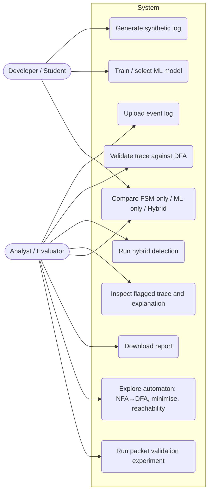

# 02 — Requirement Analysis

## 1. Requirement-to-implementation mapping (PS9 → our system)

Every PS9 statement is traced to a concrete component, test, and deliverable. "Ambiguity" IDs refer to Section 2.

| ID | PS9 requirement (professor) | Our interpretation | Component / module | Verification | Ambiguity |
|---|---|---|---|---|---|
| P9-1 | Represent normal business/software processes as finite-state machines | Order & Payment lifecycle as a **complete DFA** (explicit dead state) defined in `workflows/order_payment/workflow.yaml` | `src/automata/` | Unit tests on δ; spec loader tests | A1 |
| P9-2 | Apply ML to identify unusual execution sequences | Isolation Forest on engineered sequence features + Markov sequence model; optional Random Forest | `src/workflow_ml/`, `src/research/markov.py` | ML unit tests, evaluation runs | A4 |
| P9-3 | Distinguish **valid process variations** from rule violations or significant deviations | Three-way truth: *normal*, *valid_variation* (legal, should NOT be flagged), *rule_violation*, *statistical_anomaly* | Simulator/injector, hybrid decision table | FPR measured **on valid_variation** specifically | A2 |
| P9-4 | Select a workflow; define states, events, transition rules | Order & Payment; 13 states + dead state, 11 events (doc 04) | `workflows/order_payment/` | Spec validator + reachability analysis | — |
| P9-5 | Generate or collect event logs with normal and anomalous sequences | Primary: **generate** (controlled). Optional: collect a public log for a qualitative smoke test | `workflow_ml/simulator.py`, `injector.py`, `ingest.py` | Seeded reproducibility test | A3 |
| P9-6 | Build a finite-state model to identify invalid transitions | DFA validator returns verdict + failing index/state/event/allowed events | `automata/validator.py` | Unit + property tests | A6 |
| P9-7 | Train ML to detect statistical or sequential anomalies | IF (statistical), Markov (sequential) | `workflow_ml/isolation_forest.py`, `research/markov.py` | Metrics on held-out split | A4 |
| P9-8 | Combine rule-based violations with ML anomaly scores | Decision-table hybrid; rule and ML evidence stored **separately** | `src/hybrid/` | Decision-table unit tests (all 6 branches) | A5 |
| P9-9 | Evaluate detection performance | P/R/F1/FPR/confusion matrix/latency for FSM-only, ML-only, hybrid | `workflow_ml/evaluate.py`, `scripts/run_evaluation.py` | Evaluation run stored in DB | A7 |
| P9-10 | Explain why each sequence was flagged | Rule reason (state, event, position, allowed events) + ML reason (top deviating features / most surprising transitions) | `automata/explain.py`, `workflow_ml/explain.py`, `hybrid/explanation.py` | Explanation completeness test: every flagged case has ≥1 explanation row | A9 |
| P9-11 | TOC: state-transition systems, DFA, regular languages, reachability | Doc 04; reachability + co-reachability + dead/unreachable analyser | `automata/reachability.py` | Seeded defective-spec tests | — |
| P9-12 | ML techniques: Isolation Forest, clustering, Random Forest, sequence models | IF [M]; Markov sequence model [M]; K-Means distance score [R] (M3 research); Random Forest [R, conditional] | see doc 05 | — | A4 |
| P9-13 | Dashboard: execution paths, highlight unusual transitions, anomaly scores | Streamlit pages: path over FSM diagram with failing edge in red; score gauges/tables | `src/dashboard/` | Manual demo checklist + API contract tests | A10 |
| Brief-1 | Real packet data as small validation layer (10–15 %) | Independent module `src/packet/`; tables with no FK into main tables | `src/packet/` | Packet unit tests + scenario table | A8 |
| Brief-2 | DB, backend, frontend, Docker, deployment | PostgreSQL, FastAPI, Streamlit, Docker Compose, free-tier deployment | `src/db`, `src/api`, `src/dashboard`, `docker/` | Integration + E2E tests | A11 |
| Brief-3 | Equal 3-member distribution | Doc 10 | — | Contribution matrix | A12 |

## 2. Ambiguities and unresolved decisions (flagged, not silently assumed)

| ID | Ambiguity | Our working assumption | Who must confirm / when |
|---|---|---|---|
| A1 | PS says "finite-state machines"; DFA vs general FSM vs NFA not specified | Use a **complete DFA** as the reference model; NFA used for variation modelling and conversion demo | Team; confirm with TA at kickoff |
| A2 | "Significantly deviate from observed behaviour" has no quantitative definition | Operational definition: statistical anomaly = rule-valid trace whose anomaly score exceeds a threshold calibrated on validation data (target FPR, default 5 %) | Team; document the value used |
| A3 | "Generate or collect" — which one? | Generate as the primary labelled dataset; optionally collect one public log for qualitative checks | TA confirmation recommended |
| A4 | Which ML techniques are *required* from the PS list? | IF + Markov mandatory; clustering (K-Means distance) recommended; Random Forest conditional on label reliability (it learns our injector → report as "supervised reference", not real detection) | Team |
| A5 | How to "combine" scores | Decision-table hybrid (explainable) as primary; weighted score only as a documented alternative | Members 1–3 jointly |
| A6 | Is an **incomplete** trace (valid prefix, not yet Closed) an anomaly? | No: verdict `VALID_PREFIX` ("in progress"). Main evaluation uses **complete** cases only | Team |
| A7 | Ground truth for evaluation | Injected labels (synthetic). No claim of real fraud labels. Public logs have no anomaly labels | Team |
| A8 | Does a TCP lifecycle count as acceptable supplementary work for PS9? | Treated as a supplementary experiment, not the PS9 workflow | **Confirm with faculty/TA — status: UNCONFIRMED** |
| A9 | "Explain why each sequence was flagged" — also for unflagged? | Explanations stored for every flagged case; available on demand for any case | Team |
| A10 | "Display execution paths" granularity | Per-trace path over the DFA diagram, plus aggregate edge-frequency view | Team |
| A11 | Free-tier hosting terms change | Verify current limits when deploying; do not rely on remembered terms | Whoever leads deployment |
| A12 | Earlier chat suggested packet work for Member 2; the revision places it with Member 3 | **Revision overrides**: packet validation → Member 3 | Resolved |
| A13 | Deadline / total weeks unknown | Roadmap assumes 8 weeks; compressible to 6 by dropping [E] items | Team |
| A14 | Whether event timestamps are required by PS | PS does not require them; we include timestamps because timing-based statistical anomalies need them | Team |

## 3. Functional requirements

| ID | Requirement | Priority | Owner (primary) |
|---|---|---|---|
| FR-01 | Load a workflow spec (states, events, transitions, initial, accepting) from YAML and build a DFA | [M] | M1 |
| FR-02 | Validate a trace and return verdict ∈ {VALID_COMPLETE, VALID_PREFIX, INVALID} with failing index/state/event/allowed events and visited state path | [M] | M1 |
| FR-03 | Build an NFA (with ε-moves) for workflow variations and convert to DFA by subset construction | [M] | M1 |
| FR-04 | Minimise a DFA and check language equivalence between two DFAs | [M] | M1 |
| FR-05 | Reachability analysis: unreachable states, dead (non-co-reachable) states, report | [M] | M1 |
| FR-06 | Generate reproducible synthetic logs (seeded) with labelled classes and anomaly types | [M] | M2 |
| FR-07 | Ingest CSV event logs (`case_id, activity, timestamp`) and build traces | [M] | M2 |
| FR-08 | Extract documented feature vectors from traces | [M] | M2 |
| FR-09 | Train/score Isolation Forest; persist model + feature spec + seed | [M] | M2 |
| FR-10 | Train/score Random Forest on injected labels | [R] | M2 |
| FR-11 | Markov sequence anomaly detector | [M] | M3 |
| FR-12 | K-Means distance anomaly score (comparison) | [R] | M3 |
| FR-13 | Hybrid decision with separate rule and ML evidence | [M] | M3 |
| FR-14 | Per-trace explanation (rule reason + ML reason) | [M] | M3 (hybrid) with M1/M2 sources |
| FR-15 | Persist datasets, cases, events, FSM results, predictions, decisions, explanations, evaluation runs | [M] | all (table ownership, doc 08) |
| FR-16 | REST API per doc 08 | [M] | all (router ownership) |
| FR-17 | Dashboard pages per doc 09 incl. execution path with failing edge highlighted | [M] | all (page ownership) |
| FR-18 | Downloadable reports (CSV + JSON) | [M] | M3 (primary), M2 (shell) |
| FR-19 | Independent packet experiment: parse small pcap → flows → TCP events → simplified TCP FSM → verdicts | [M] | M3 |
| FR-20 | Dashboard section for the packet experiment, visibly separate | [M] | M3 |
| FR-21 | Evaluation of FSM-only vs ML-only vs hybrid | [M] | M3 (primary) |
| FR-22 | PDF/HTML report export | [E] | M3 |
| FR-23 | XES import (pm4py) | [E] | M2 |
| FR-24 | Bounded-retry DFA variant (k attempts) and state-growth demo | [R] | M1 |

## 4. Non-functional requirements

| ID | Requirement | Measure |
|---|---|---|
| NFR-01 Correctness | DFA validation is exact and deterministic | Property tests: minimised DFA ≡ original on all strings up to length N |
| NFR-02 Reproducibility | Same seed → same dataset, splits, model | Hash comparison test |
| NFR-03 Performance | DFA validation O(n) per trace | Latency measured and recorded (no target invented) |
| NFR-04 Explainability | Every flagged case has a stored explanation | Automated check in integration tests |
| NFR-05 No fabricated results | No hardcoded metrics, scores, or demo numbers anywhere in runtime code | Code review checklist + grep test for literal metric dicts in `src/` |
| NFR-06 Modularity | Modules communicate only through `src/common` types | Import-linter or review rule |
| NFR-07 Portability | `docker compose up` runs everything locally | CI smoke test |
| NFR-08 Security basics | No secrets in git; upload size limits; only load model artefacts we produced | `.env`, size limits, doc 13 |
| NFR-09 Maintainability | Type hints, docstrings, lint (ruff), formatter | CI |
| NFR-10 Test coverage | Target ≥ 80 % lines for `automata/`, `hybrid/`; reasonable coverage elsewhere (target, not a guarantee) | pytest-cov |

## 5. Use-case diagram

## 6. Assumptions

1. Python 3.11+ on all machines; Docker Desktop available to every member.
2. Packet captures used contain only traffic from the team's own authorised lab or a public sample; no third-party personal data is committed to the repository.
3. The faculty accepts a supplementary TCP experiment (A8 — to be confirmed).
