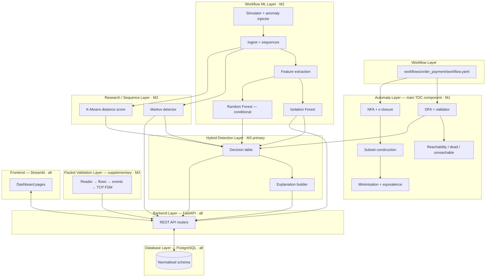
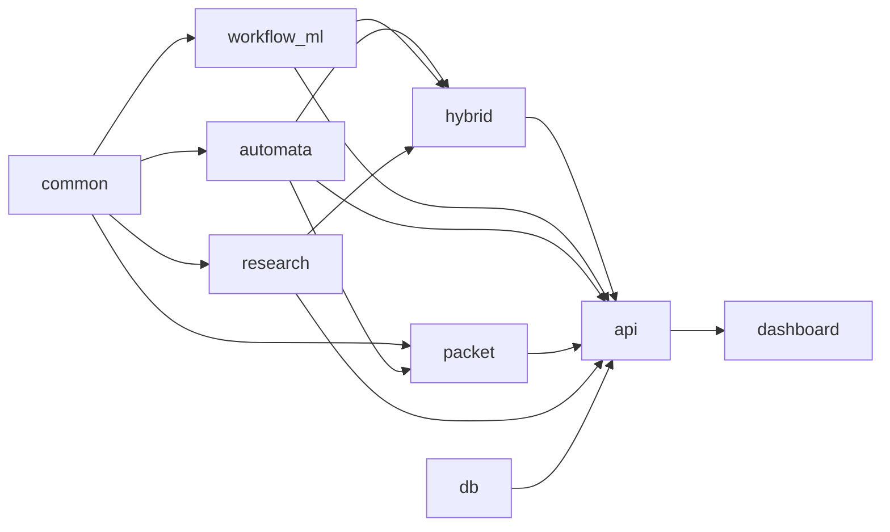
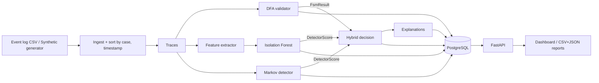
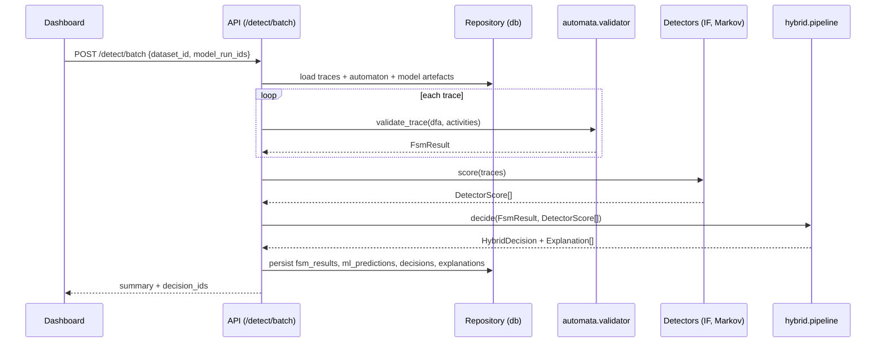
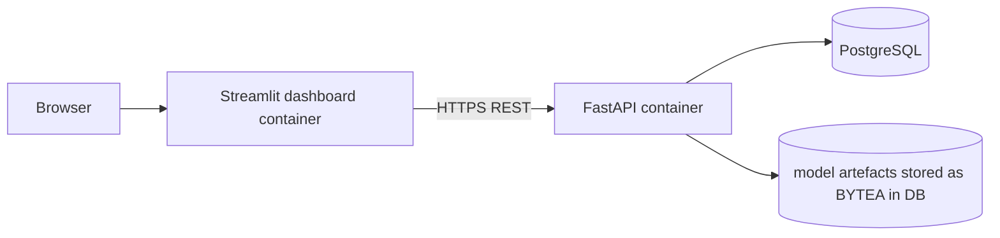

# 03 — System Architecture

## 1. Layered architecture



**Isolation rule:** the Packet Validation Layer has **no dependency** on L3/L3b/L4 and no foreign keys into main-workflow tables. It reuses only the generic automata classes from `src/automata` (DFA data structure and validator), which is itself evidence that the automata engine is workflow-agnostic.

## 2. Module dependency rules



Rules:
1. `src/common` holds only dataclasses, protocols, config; **no business logic**.
2. `automata`, `workflow_ml`, `research` never import each other; they communicate through `common` types.
3. `dashboard` imports **only** `requests`/`httpx` and plotting libraries — never ML or automata code. Everything displayed comes from the API, so the dashboard cannot show fabricated numbers.
4. `hybrid` is the only module that sees both rule evidence and ML evidence.

## 3. Data-flow diagram (level 1)



## 4. Sequence diagram — analysing a batch



## 5. Deployment architecture (target)



Locally the same three pieces run via `docker compose up`. Free-tier hosting specifics are in doc 13 and must be verified at deployment time.

## 6. Shared contracts (`src/common`)

Python types (authoritative; all members code against these):

```python
# src/common/types.py
from dataclasses import dataclass, field
from datetime import datetime
from enum import Enum
from typing import Optional


@dataclass(frozen=True)
class Event:
    case_id: str
    activity: str
    timestamp: datetime  # timezone-aware UTC
    attributes: dict = field(default_factory=dict)


@dataclass
class Trace:
    case_id: str
    events: list[Event]  # sorted by (timestamp, original_row_index)

    @property
    def activities(self) -> list[str]:
        return [e.activity for e in self.events]


class FsmVerdict(str, Enum):
    VALID_COMPLETE = "VALID_COMPLETE"  # ends in accepting state
    VALID_PREFIX = "VALID_PREFIX"  # all transitions legal, not yet accepting
    INVALID = "INVALID"  # illegal transition or unknown event


@dataclass
class FsmResult:
    case_id: str
    verdict: FsmVerdict
    state_path: list[str]  # states visited, len = events processed + 1
    fail_index: Optional[int] = None  # 0-based index of offending event
    fail_state: Optional[str] = None
    fail_event: Optional[str] = None
    allowed_events: list[str] = field(default_factory=list)
    reason_code: Optional[str] = None  # ILLEGAL_TRANSITION | UNKNOWN_EVENT | EVENT_AFTER_FINAL


@dataclass
class Factor:  # one human-readable reason element
    name: str
    value: float
    reference: float
    note: str


@dataclass
class DetectorScore:
    case_id: str
    detector: str  # "isolation_forest" | "markov" | "kmeans" | "random_forest"
    raw_score: float  # HIGHER = MORE ANOMALOUS (convention for all detectors)
    norm_score: float  # in [0,1]: ECDF rank vs training-score distribution
    threshold: float  # on norm_score, calibrated on validation data
    is_anomaly: bool
    factors: list[Factor] = field(default_factory=list)


class FinalLabel(str, Enum):
    NORMAL = "NORMAL"
    RULE_VIOLATION = "RULE_VIOLATION"
    STATISTICAL_ANOMALY = "STATISTICAL_ANOMALY"
    IN_PROGRESS = "IN_PROGRESS"


@dataclass
class HybridDecision:
    case_id: str
    final_label: FinalLabel
    fsm: FsmResult
    ml: list[DetectorScore]
    explanation: list[str]  # ordered, human-readable
```

```python
# src/common/interfaces.py
from typing import Protocol, Sequence


class AnomalyDetector(Protocol):
    name: str

    def fit(self, traces: Sequence[Trace]) -> None: ...  # normal-only data for unsupervised
    def calibrate(
        self, traces: Sequence[Trace], target_fpr: float
    ) -> None: ...  # validation normals only
    def score(self, traces: Sequence[Trace]) -> list[DetectorScore]: ...
    def to_bytes(self) -> bytes: ...
    @classmethod
    def from_bytes(cls, b: bytes) -> "AnomalyDetector": ...
```

**Score convention (important for leakage and consistency):** scikit-learn's `IsolationForest.score_samples` returns *higher = more normal*; our wrapper returns `raw_score = -score_samples` so that **higher always means more anomalous** for every detector.

## 7. Technology choices (purpose of each; nothing unnecessary)

| Technology | Purpose | Why not something heavier |
|---|---|---|
| Python 3.11 | Single language for all layers | Keeps three students on one stack |
| pandas, NumPy | Log handling, features | Standard |
| scikit-learn | Isolation Forest, Random Forest, K-Means, metrics | Everything needed; no deep learning required |
| Scapy (`PcapReader`) | Read small pcap files for the supplementary experiment | Pure-Python, easy install; PyShark needs tshark installed |
| FastAPI + Uvicorn + Pydantic | REST API with auto-generated OpenAPI docs | Typed contracts match `common/types.py` |
| SQLAlchemy 2 + Alembic | ORM + migrations | Portable between PostgreSQL and SQLite (tests) |
| PostgreSQL 16 | Relational store | JSONB + BYTEA useful; free hosted tiers exist (verify) |
| Streamlit | Dashboard in Python; multipage; each member owns pages | React would add a second language/toolchain for a 3-person team |
| Plotly | Interactive charts | Works natively in Streamlit |
| Graphviz (`graphviz` Python pkg + system binary) | Draw DFA/NFA with highlighted edges | Standard for automata diagrams; DOT export also works without the binary |
| pytest, pytest-cov, hypothesis [R] | Unit/property tests | Property tests are ideal for automata equivalence |
| ruff + black (or ruff format) | Lint/format | One tool, fast |
| Docker + Docker Compose | Reproducible run | Required by brief |
| GitHub + GitHub Actions | VCS + CI | Required by brief |
| pm4py [E] | XES import only | Skip unless XES logs are used |
| SHAP [E] | Optional ML explanation | Default explanation is simple and deterministic |
