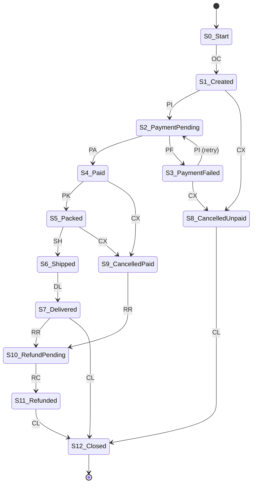

# 04 — TOC Automata Design (Main Academic Contribution)

Owner: **Member 1**. This is the central theoretical component. All statements in Section 6 marked *expected* are **hand-derived predictions that the implementation must confirm by test** — they are not experimental results.

## 1. Workflow: Online Order & Payment Lifecycle

### 1.1 Events (alphabet Σ, |Σ| = 11)

| Symbol | Event | Meaning |
|---|---|---|
| OC | `OrderCreated` | Customer places order |
| PI | `PaymentInitiated` | A payment attempt starts (first or retry) |
| PA | `PaymentAuthorized` | Payment succeeded |
| PF | `PaymentFailed` | Payment attempt failed |
| PK | `OrderPacked` | Warehouse packed order |
| SH | `OrderShipped` | Order handed to carrier |
| DL | `OrderDelivered` | Delivered to customer |
| CX | `OrderCancelled` | Order cancelled |
| RR | `RefundRequested` | Refund requested (after cancel-when-paid, or return after delivery) |
| RC | `RefundCompleted` | Refund paid out |
| CL | `OrderClosed` | Case closed (terminal) |

### 1.2 States (Q, |Q| = 14 including the dead/trap state)

| State | Name | Meaning |
|---|---|---|
| S0 | Start | Nothing has happened (initial) |
| S1 | Created | Order exists, no payment started |
| S2 | PaymentPending | A payment attempt is in progress |
| S3 | PaymentFailed | Last payment attempt failed |
| S4 | Paid | Payment authorised |
| S5 | Packed | Packed, not yet shipped |
| S6 | Shipped | In transit |
| S7 | Delivered | Delivered |
| S8 | CancelledUnpaid | Cancelled before any successful payment |
| S9 | CancelledPaid | Cancelled after payment; refund required |
| S10 | RefundPending | Refund requested |
| S11 | Refunded | Refund completed |
| S12 | Closed | **Accepting** final state |
| S_dead | Dead | Trap state for every illegal transition |

### 1.3 Formal definition

M = (Q, Σ, δ, q₀, F) with q₀ = S0, F = {S12}, and δ: Q × Σ → Q total (every undefined move goes to S_dead, and S_dead loops to itself on every symbol).

### 1.4 Transition function δ (non-dead moves; all others → S_dead)

| From | Event → To |
|---|---|
| S0 Start | OC → S1 |
| S1 Created | PI → S2 ; CX → S8 |
| S2 PaymentPending | PA → S4 ; PF → S3 |
| S3 PaymentFailed | PI → S2 *(retry)* ; CX → S8 |
| S4 Paid | PK → S5 ; CX → S9 |
| S5 Packed | SH → S6 ; CX → S9 |
| S6 Shipped | DL → S7 |
| S7 Delivered | RR → S10 *(return)* ; CL → S12 |
| S8 CancelledUnpaid | CL → S12 |
| S9 CancelledPaid | RR → S10 |
| S10 RefundPending | RC → S11 |
| S11 Refunded | CL → S12 |
| S12 Closed | *(none — any event is a violation: EVENT_AFTER_FINAL)* |

**Design choices** (document, they are assumptions): cancelling is not allowed while a payment is `PaymentPending` (S2); there is no cancellation after shipping (returns go through Delivered → RR); retries are *unbounded* in the base DFA (bounded variant in §7).

### 1.5 State diagram


(The dead state and its incoming "everything else" edges are omitted from the diagram for readability; the data structure includes them explicitly.)

### 1.6 The language accepted

L(M) = set of all event strings that drive M from S0 to S12. As a regular expression over Σ (juxtaposition = concatenation, `|` = union):

```
Pay   = PI (PF PI)* PA                         -- reach Paid after zero or more failed attempts
Fail  = PI (PF PI)* PF                         -- reach PaymentFailed
Refnd = RR RC CL                               -- refund then close

L = OC (  (ε | Fail) CX CL                     -- cancelled before any payment succeeded
        | Pay ( CX Refnd                       -- cancelled right after payment
              | PK ( CX Refnd                  -- cancelled after packing
                   | SH DL ( CL | Refnd ) ) ) ) -- delivered, then close or return+refund
```

Because L is described by a regular expression (and equivalently accepted by the finite automaton M), **L is a regular language**.

## 2. Valid vs invalid traces — worked examples

| Trace | Verdict | Why |
|---|---|---|
| OC PI PA PK SH DL CL | VALID_COMPLETE | Happy path |
| OC PI PF PI PA PK SH DL CL | VALID_COMPLETE | One retry — a *valid process variation* |
| OC CX CL | VALID_COMPLETE | Cancel before payment |
| OC PI PA PK SH DL RR RC CL | VALID_COMPLETE | Return with refund |
| OC PI PA PK SH | VALID_PREFIX | Legal so far, not yet closed (in progress) |
| OC PI PA SH … | INVALID (ILLEGAL_TRANSITION) | `SH` in S4 Paid — packing skipped; allowed: PK, CX |
| OC PK … | INVALID | `PK` in S1 Created — shipped/packed without payment |
| OC PI PA PK SH DL CL PK | INVALID (EVENT_AFTER_FINAL) | Anything after Closed |
| OC PI PF PI PF PI PF PI PF PI PF PI PA … | VALID_* (!) | 6 failures are legal for the DFA — **only ML can flag this** |
| OC FOO … | INVALID (UNKNOWN_EVENT) | Symbol not in Σ |

The last-but-one row is the formal motivation for the ML layer.

## 3. What a DFA cannot express (motivation for ML)

1. **Unbounded counting constraints** such as "the number of shipped items equals the number of ordered items" generate a language like { aⁿ bⁿ }, which is **not regular** (pumping lemma: pump the a-block and the counts no longer match). A finite-state monitor cannot check it.
2. **Statistical/temporal properties** (rate of retries, time between events) are not part of the symbol sequence at all.
3. A *bounded* version of counting **is** regular (see §7): "at most k payment attempts" needs about 2k states. So the FSM can enforce hard, fixed limits, but not "unusual relative to history".

## 4. NFA for workflow variations and NFA→DFA conversion

### 4.1 NFA construction (Member 1 implements)

`src/automata/nfa.py` provides Thompson-style combinators producing an ε-NFA: `symbol(a)`, `concat(A,B)`, `union(A,B)`, `star(A)`, `epsilon()`. The order-workflow NFA is built programmatically from the regular expression in §1.6 (`build_order_payment_nfa()`), giving a natural source of optional paths (union) and retries (star) with ε-transitions.

### 4.2 Worked example — payment block `PI (PF PI)* PA`

ε-NFA: a –PI→ b ; b –ε→ c ; c –PF→ d ; d –PI→ b ; b –PA→ e ; start = a, accept = {e}.

ε-closure(a) = {a}; ε-closure(b) = {b, c}.

| DFA state | Subset | on PI | on PF | on PA | Accepting |
|---|---|---|---|---|---|
| A | {a} | B | ∅ | ∅ | no |
| B | {b, c} | ∅ | C | D | no |
| C | {d} | B (ε-closure of {b} = {b,c}) | ∅ | ∅ | no |
| D | {e} | ∅ | ∅ | ∅ | **yes** |

Minimisation: A and C are both non-accepting and both have only `PI → B`, so **A ≡ C** (Myhill–Nerode equivalent). Minimal DFA has 3 live states: X –PI→ B, B –PF→ X, B –PA→ D. Check: PI PF PI PA ∈ L: X→B→X→B→D ✓. (Dead state omitted.) This example is also a required unit test.

### 4.3 Subset construction (pseudocode)

```
function NFA_TO_DFA(N):
    start ← ε_closure({N.start})
    worklist ← [start]; DFA.states ← {start}
    while worklist not empty:
        S ← pop(worklist)
        for a in Σ:
            T ← ε_closure( ⋃_{q∈S} N.δ(q, a) )
            if T = ∅: continue                    # dead state added in completion step
            DFA.δ(S, a) ← T
            if T not in DFA.states: add T; push T
    DFA.accepting ← { S : S ∩ N.accepting ≠ ∅ }
    return complete(DFA)                          # add explicit dead state
```
Worst case 2^|Q_N| states; for our NFA it is small.

## 5. DFA minimisation (Moore partition refinement; Hopcroft is [E])

```
function MINIMISE(D):                 # D must be complete
    D ← remove_unreachable(D)
    P ← { F, Q \ F }  (drop empty blocks)
    repeat
        P' ← refine each block B by signature(q) = ( block_of(δ(q,a)) for a in Σ )
        changed ← (P' ≠ P);  P ← P'
    until not changed
    return quotient automaton over blocks P
```
Complexity: O(|Σ|·|Q|²) worst case (Moore). Output state names: keep the lexicographically smallest member name and store the merged set in `merged_from` for the dashboard.

## 6. Expected structural results (hand-derived — MUST be confirmed by implementation)

| Quantity | Expected | Basis |
|---|---|---|
| Live states in hand-designed DFA | 13 (S0–S12) | table §1.2 |
| Complete DFA incl. dead | 14 | + S_dead |
| Equivalent pairs | **S1 ≡ S3** (`Created` ≡ `PaymentFailed`: both non-accepting, both {PI→S2, CX→S8}); **S8 ≡ S11** (`CancelledUnpaid` ≡ `Refunded`: both non-accepting, both only {CL→S12}) | Myhill–Nerode |
| Minimal complete DFA | 12 states (11 live + dead) | 14 − 2 merges |
| Reachable states from S0 | all 13 live states | BFS |
| Dead (non-co-reachable) live states | none; only S_dead cannot reach F | backward BFS |
| Unreachable states | none | BFS |
| NFA→DFA→minimised vs hand DFA | language-equivalent; minimal DFAs isomorphic | equivalence check |

If any of these does not hold in code, treat it as a defect in either the spec or the algorithm and document the resolution — do not edit the expected table to match the code without understanding why.

**Why keep the non-minimal DFA for monitoring?** Merged states lose business meaning (S1 "Created" vs S3 "PaymentFailed" give different explanations). Monitoring and explanations use the **semantic DFA**; the minimised DFA is used for equivalence proof and the theory demonstration.

## 7. Reachability analysis

Definitions:
- **Reachable state**: reachable from q₀ by some string.
- **Unreachable state**: not reachable → useless; indicates a spec error.
- **Co-reachable state**: some accepting state is reachable from it.
- **Dead state**: not co-reachable (trap). The explicit S_dead is expected; any *other* dead live state signals a spec error (a process that can never finish).

```
function ANALYSE(D):
    R  ← BFS forward from D.start                       # reachable
    G  ← reverse graph of D.δ
    C  ← BFS backward from D.accepting over G           # co-reachable
    return { unreachable: Q \ R,
             dead: Q \ C,
             useful: R ∩ C }
```
Additional queries exposed to the dashboard: shortest valid trace to a given state (BFS parent pointers); "can event e ever occur?" (does any reachable state have an e-edge to a non-dead state).

**Required spec-defect tests (real functionality, not mocks):** build deliberately defective specs — (a) an orphan state with no incoming edge, (b) a live state with no path to Closed — and assert the analyser reports exactly those states.

## 8. Optional bounded-retry DFA (variant, [R])

DFA_k: allows at most k payment attempts. States `S2_i` (PaymentPending, attempt i) and `S3_i` (PaymentFailed after attempt i), i = 1..k; `S3_k` has no PI edge. State count grows ≈ 2k plus constants — demonstrates that *fixed* counting is regular but costs states, and that the unbounded base DFA plus ML is more economical for "usual vs unusual retry counts". Generated by `automata/variants.py::bounded_retry_dfa(k)`; verify L(DFA_k) ⊂ L(M) and equality as k→∞ on bounded-length strings.

## 9. Explanation generation from the DFA

For `INVALID` results:

```
"Event 'OrderShipped' at position 3 is not allowed in state 'Paid'.
 Allowed events here: OrderPacked, OrderCancelled.
 Path so far: Start → Created → PaymentPending → Paid."
```
Fields come directly from `FsmResult`; nothing is inferred. For `VALID_PREFIX`: "Trace is valid so far; current state 'Shipped'; next allowed: OrderDelivered."

## 10. Module specification (`src/automata/`)

| File | Responsibility | Key API |
|---|---|---|
| `dfa.py` | DFA data structure, completion, validation of well-formedness | `DFA(states, alphabet, delta, start, accepting)`, `.step(q,a)`, `.accepts(seq)`, `.complete()` |
| `nfa.py` | ε-NFA + Thompson combinators | `NFA`, `symbol, concat, union, star, epsilon`, `.epsilon_closure(S)` |
| `conversion.py` | Subset construction | `nfa_to_dfa(nfa) -> DFA` |
| `minimization.py` | Moore minimisation | `minimise(dfa) -> (DFA, merged_map)` |
| `equivalence.py` | Language equivalence via product BFS; counter-example string | `equivalent(d1,d2) -> (bool, Optional[list[str]])` |
| `reachability.py` | Analysis in §7 | `analyse(dfa) -> ReachabilityReport` |
| `loader.py` | YAML → DFA; spec lint (unknown states, duplicate edges) | `load_workflow(path) -> DFA` |
| `validator.py` | Trace validation → `FsmResult` | `validate_trace(dfa, case_id, activities) -> FsmResult` |
| `explain.py` | Text for §9 | `explain_fsm(result) -> list[str]` |
| `visualize.py` | DOT export with highlighted failing edge/path | `to_dot(dfa, highlight_path=None, fail_edge=None)` |
| `variants.py` [R] | Bounded-retry DFA | `bounded_retry_dfa(k)` |

Equivalence pseudocode:

```
function EQUIVALENT(D1, D2):                       # both complete over same Σ
    queue ← [(D1.start, D2.start)]; seen ← {…}; parent ← {}
    while queue:
        (p,q) ← pop
        if (p ∈ F1) ≠ (q ∈ F2): return (False, reconstruct_string(parent,(p,q)))
        for a in Σ: next ← (δ1(p,a), δ2(q,a)); if next ∉ seen: add, parent[next]←((p,q),a), push
    return (True, None)
```

Trace validator pseudocode:

```
function VALIDATE(D, activities):
    q ← D.start; path ← [q]
    for i, a in enumerate(activities):
        if a ∉ D.alphabet:                 return INVALID(i, q, a, UNKNOWN_EVENT)
        if q is final-and-closed:          return INVALID(i, q, a, EVENT_AFTER_FINAL)
        q' ← D.δ(q, a)
        if q' = DEAD:                      return INVALID(i, q, a, ILLEGAL_TRANSITION, allowed=D.allowed(q))
        q ← q'; path.append(q)
    return VALID_COMPLETE if q ∈ D.accepting else VALID_PREFIX
```
Time O(n) per trace of length n; space O(n) for the path.

## 11. Unit-test checklist (Member 1)

1. Every transition in §1.4 accepted; a sample of illegal ones rejected with the right reason code.
2. Table in §2 reproduced exactly.
3. §4.2 worked example: subset-construction table and minimal DFA match.
4. Property test: for random strings up to length 8, `dfa.accepts(s) == min_dfa.accepts(s) == nfa_dfa.accepts(s)`.
5. `equivalent()` returns a valid counter-example when two DFAs differ.
6. Spec-defect tests (§7).
7. Bounded-retry variant: strings with > k attempts rejected.
