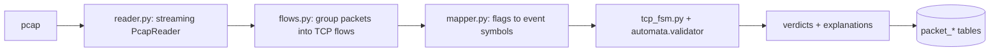
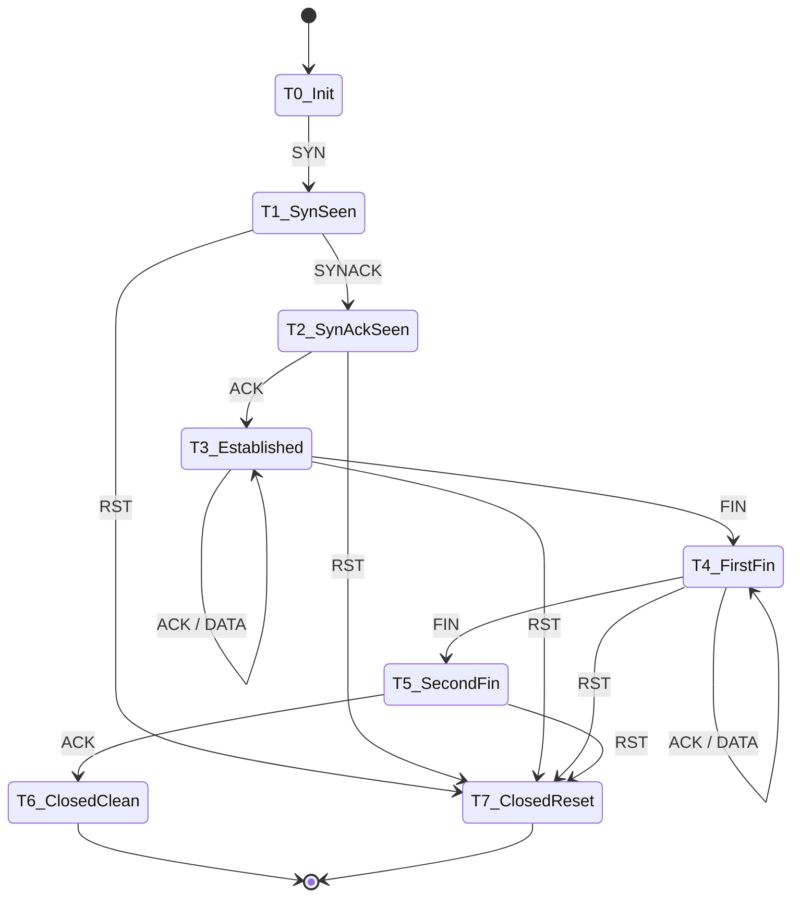

# 07 — Real Packet Validation (Supplementary, Independent Module)

Owner: **Member 3**. Reviewer: Member 1 (automata reuse). Contributor: Member 2.

> **Scope guard.** This module shows that the *same automata-validation idea* applies to another state-based system: a simplified TCP connection lifecycle. It is **not** an intrusion detection system. It must stay ≈10–15 % of project effort (planning estimate ≈10–11 %). **An FSM-invalid TCP flow is not an attack, and an FSM-valid flow is not benign** (e.g. a port-scan probe answered with RST is a perfectly legal SYN→RST sequence).

## 1. Hard scope limits

| Allowed | Not allowed |
|---|---|
| ≥ 1 small capture (few MB), a few hundred to a few thousand TCP flows | Whole-day multi-GB captures |
| One simplified FSM (two tolerance profiles) | Full RFC 793 state machine, congestion control, TLS/HTTP parsing |
| Descriptive verdict distributions and scenario-agreement table | Attack classification, detection-rate claims, CIC-style ML pipelines |
| One dashboard page + one API router | Real-time capture, dashboards of "alerts" |
Effort rule: if packet work exceeds its budget, **cut the optional CIC slice first**, not other modules.

## 2. Data sources (tiered)

**Tier A — mandatory:** (a) a small capture from an **authorised lab** (your own machine/VM, loopback, or a test server you control) with scripted scenarios, and/or (b) a small public sample capture (e.g. Wireshark sample captures). Scenarios for (a), each with an *intended* outcome known in advance:

| Scenario | How to produce (own lab only) | Intended FSM outcome |
|---|---|---|
| S1 Normal request | `curl` to a local test server | ACCEPTED_CLEAN |
| S2 Closed port | connect to a closed local port | ACCEPTED_RESET (SYN → RST) |
| S3 Abrupt abort | kill the client mid-transfer | ACCEPTED_RESET |
| S4 Truncated capture | stop capture before teardown | INCOMPLETE |
| S5 Mutated sequences | programmatically delete/reorder events of S1 flows (derived data, labelled as mutated) | INVALID |

**Tier B — optional:** one **small time-window slice** of a public labelled dataset such as CIC-IDS2017 (published as per-day pcaps plus flow-label CSVs; **verify current download page, size, licence and file layout yourself before relying on any detail**). Use it only for descriptive comparison (§7).

Ethics/legal: capture only on networks/hosts you own or have written permission to monitor; do not sniff college/public networks; do not commit raw captures containing third-party data; never run scanning/flooding tools against systems you do not own — this project does not need them.

## 3. Pipeline

### 3.1 Reader
Use `scapy.utils.PcapReader` (streaming; `rdpcap` loads everything into memory). Keep only IPv4/IPv6 + TCP packets; record timestamp, src/dst IP and port, TCP flags, payload length. Stop after a configured packet or flow limit (`PACKET_MAX_PACKETS`).

### 3.2 Flow reconstruction
- Key: bidirectional 5-tuple (endpoints sorted so both directions map to one key).
- Order by capture timestamp (stable by packet index).
- **Initiator** = sender of the first SYN; direction labels `C→S`/`S→C` stored for display.
- **Port reuse:** if the flow is already in a terminal state and a new SYN arrives, start a new flow instance.
- **Mid-stream flows** (first packet is not a SYN): marked `MIDSTREAM` and *excluded from FSM verdict statistics* (counted and reported).

### 3.3 Flag → event mapping (precedence top to bottom)

| Condition on TCP flags / payload | Event |
|---|---|
| RST set | `RST` |
| SYN and ACK set | `SYNACK` |
| SYN set | `SYN` |
| FIN set | `FIN` |
| payload length > 0 | `DATA` |
| ACK set (no payload) | `ACK` |
| anything else (null/odd flags) | `OTHER` (not in alphabet ⇒ UNKNOWN_EVENT) |

Payload length is taken from the captured data; if the capture used a small snaplen, `DATA` may be misclassified — record snaplen in experiment metadata.

## 4. Simplified TCP FSM

Σ_tcp = {SYN, SYNACK, ACK, DATA, FIN, RST}. Initial T0. Accepting: T6 (clean close) and T7 (reset).

| State | Name | Transitions (strict profile) |
|---|---|---|
| T0 | Init | SYN → T1 |
| T1 | SynSeen | SYNACK → T2 ; RST → T7 |
| T2 | SynAckSeen | ACK → T3 ; RST → T7 |
| T3 | Established | ACK → T3 ; DATA → T3 ; FIN → T4 ; RST → T7 |
| T4 | FirstFin | ACK → T4 ; DATA → T4 ; FIN → T5 ; RST → T7 |
| T5 | SecondFin | ACK → T6 ; RST → T7 |
| T6 | ClosedClean | *(terminal)* |
| T7 | ClosedReset | *(terminal)* |
| T_dead | Dead | all → T_dead |

**Tolerant profile** additionally allows: repeated `SYN` in T1, repeated `SYNACK` in T2, repeated `FIN` in T4/T5, and one trailing `ACK` in T6. Both profiles are DFAs loaded from `src/packet/tcp_fsm.yaml` into the **same** `automata.dfa.DFA` class used for the main workflow.

### 4.1 Packet verdicts

| Verdict | Condition |
|---|---|
| `ACCEPTED_CLEAN` | ends in T6 |
| `ACCEPTED_RESET` | ends in T7 |
| `INCOMPLETE` | all transitions legal, ends in non-terminal state (capture ended) |
| `INVALID` | illegal transition or unknown event; failing index/state/event stored |
| `MIDSTREAM` | no SYN observed; excluded from FSM statistics |

### 4.2 TOC extension (cheap, high value)
Use `automata.equivalence` to show **strict ⊂ tolerant** (product construction gives a counter-example string such as `SYN SYN …` accepted only by the tolerant profile). This ties the supplementary module back to the main TOC contribution.

## 5. What we evaluate (and what we do not)

1. **Scenario-agreement table** (Tier A): for each scenario, intended outcome vs FSM verdict, per profile. Agreement counts only; no accuracy-style claims beyond "agrees with the intended scenario on N of M flows".
2. **Verdict distribution** per profile on the full small capture, including `MIDSTREAM` counts.
3. **False-violation analysis:** for flows from *known-benign* scenario traffic that the strict profile marks INVALID, identify causes (retransmission, simultaneous close, keep-alive, truncated snaplen). This is expected to be informative and is reported as findings **after** running.
4. **Optional Tier B:** descriptive cross-tab of FSM verdicts × dataset flow labels for a small slice, with the explicit caveat that dataset labels describe attack campaigns, not protocol validity.

## 6. Label alignment (Tier B only)

1. Cut a small window (minutes) from the pcap (`editcap` from Wireshark, or stop Scapy after N packets).
2. Build flows with the same 5-tuple definition used by the dataset's flow CSV.
3. Join on (src IP, src port, dst IP, dst port, protocol) in both directions with a **time tolerance**; check empirically for timezone offsets before choosing the tolerance.
4. Report match rate; **exclude and count** unmatched flows. Never impute labels.
5. Treat labels as descriptive — published critiques discuss label-quality issues in this dataset; read them and note relevant caveats in the report.

## 7. Limitations (must appear in the report)

- Simplified FSM: no retransmission modelling in strict mode, no simultaneous open/close, no half-open scans, no SACK/window logic.
- Capture artefacts: snaplen, offload, packet loss, asymmetric routing, mid-stream starts.
- FSM validity ≠ benign; FSM invalidity ≠ malicious.
- Tiny sample ⇒ no statistical generalisation.

## 8. Module spec (`src/packet/`)

| File | Role | I/O |
|---|---|---|
| `reader.py` | Stream packets | `read_packets(path, max_packets) -> Iterator[PacketRecord]` |
| `flows.py` | Group into flows, mark mid-stream | `build_flows(records) -> list[Flow]` |
| `mapper.py` | Flags → symbols (§3.3) | `to_events(flow) -> list[str]` |
| `tcp_fsm.yaml` / `tcp_fsm.py` | Load strict/tolerant DFAs | `load_tcp_dfa(profile) -> DFA` |
| `evaluate.py` | Verdicts, scenario agreement, false-violation report | `run_experiment(pcap, scenario_map, profile) -> ExperimentReport` |
| `scenarios/README.md` | Exact lab commands + expected outcomes | documentation |

Output format (JSON): `{experiment_id, profile, flows:[{flow_id, src, dst, n_events, events[], verdict, fail_index, fail_state, fail_event, scenario?}], summary:{counts_by_verdict, midstream_excluded}}`.

Independent tests: hand-built packet records for each §4 path (clean close, reset, invalid order, midstream, port reuse, unknown flags) → expected verdicts; no pcap file required for unit tests.
