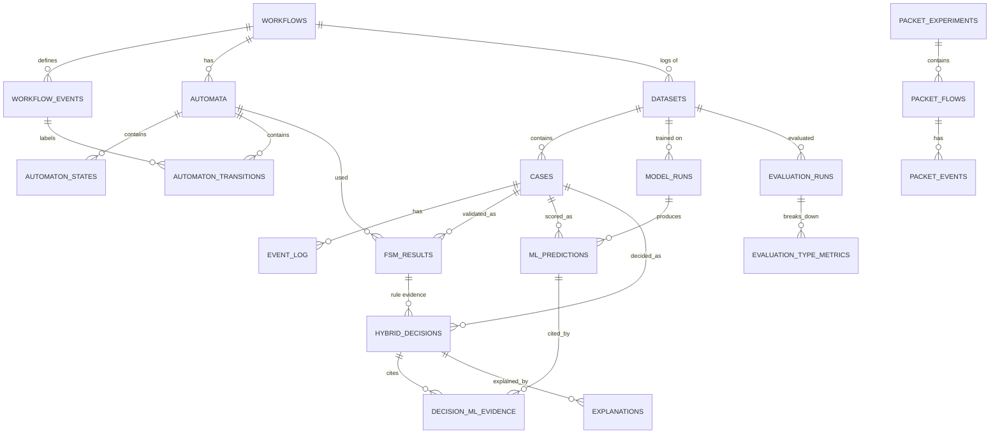

# 08 — Database and API Design

Database: PostgreSQL 16 (SQLite in unit tests via SQLAlchemy). Migrations: Alembic. **Table ownership is split three ways** so each member designs, migrates and tests their own tables; the whole schema is reviewed jointly (doc 10, task S2).

## 1. Entity-relationship diagram


`PACKET_*` tables intentionally have **no relation** to the main-workflow tables.

## 2. Ownership

| Owner | Tables |
|---|---|
| Member 1 | `workflows`, `workflow_events`, `automata`, `automaton_states`, `automaton_transitions`, `fsm_results` |
| Member 2 | `datasets`, `cases`, `event_log`, `model_runs`, `ml_predictions` |
| Member 3 | `hybrid_decisions`, `decision_ml_evidence`, `explanations`, `evaluation_runs`, `evaluation_type_metrics`, `packet_experiments`, `packet_flows`, `packet_events` |

## 3. SQL schema (PostgreSQL)

```sql
-- ===== Member 1 =====
CREATE TABLE workflows (
  workflow_id   SERIAL PRIMARY KEY,
  name          TEXT NOT NULL,
  version       TEXT NOT NULL,
  description   TEXT,
  created_at    TIMESTAMPTZ NOT NULL DEFAULT now(),
  UNIQUE (name, version)
);
CREATE TABLE workflow_events (
  event_id      SERIAL PRIMARY KEY,
  workflow_id   INT NOT NULL REFERENCES workflows ON DELETE CASCADE,
  code          TEXT NOT NULL,            -- 'PI'
  name          TEXT NOT NULL,            -- 'PaymentInitiated'
  UNIQUE (workflow_id, code), UNIQUE (workflow_id, name)
);
CREATE TABLE automata (
  automaton_id  SERIAL PRIMARY KEY,
  workflow_id   INT NOT NULL REFERENCES workflows ON DELETE CASCADE,
  kind          TEXT NOT NULL CHECK (kind IN ('DFA','NFA','MIN_DFA','BOUNDED_DFA')),
  label         TEXT NOT NULL,
  derived_from  INT REFERENCES automata,   -- e.g. MIN_DFA derived from a DFA
  created_at    TIMESTAMPTZ NOT NULL DEFAULT now()
);
CREATE TABLE automaton_states (
  automaton_id  INT NOT NULL REFERENCES automata ON DELETE CASCADE,
  state_name    TEXT NOT NULL,
  is_initial    BOOLEAN NOT NULL DEFAULT FALSE,
  is_accepting  BOOLEAN NOT NULL DEFAULT FALSE,
  is_dead       BOOLEAN NOT NULL DEFAULT FALSE,
  merged_from   TEXT[],                    -- filled for MIN_DFA
  PRIMARY KEY (automaton_id, state_name)
);
CREATE TABLE automaton_transitions (
  automaton_id  INT NOT NULL,
  from_state    TEXT NOT NULL,
  event_id      INT,                       -- NULL means epsilon (NFA)
  to_state      TEXT NOT NULL,
  FOREIGN KEY (automaton_id, from_state) REFERENCES automaton_states ON DELETE CASCADE,
  FOREIGN KEY (automaton_id, to_state)   REFERENCES automaton_states ON DELETE CASCADE,
  FOREIGN KEY (event_id) REFERENCES workflow_events
);
CREATE UNIQUE INDEX uq_dfa_transition ON automaton_transitions (automaton_id, from_state, event_id)
  WHERE event_id IS NOT NULL;   -- (applies meaningfully to DFAs; NFAs may need a separate check in code)

-- ===== Member 2 =====
CREATE TABLE datasets (
  dataset_id    SERIAL PRIMARY KEY,
  workflow_id   INT NOT NULL REFERENCES workflows,
  name          TEXT NOT NULL,
  source_kind   TEXT NOT NULL CHECK (source_kind IN ('synthetic','uploaded','public_log')),
  label_semantics TEXT NOT NULL CHECK (label_semantics IN ('injected','none','external')),
  seed          INT,
  config_hash   TEXT,
  created_at    TIMESTAMPTZ NOT NULL DEFAULT now()
);
CREATE TABLE cases (
  case_pk       BIGSERIAL PRIMARY KEY,
  dataset_id    INT NOT NULL REFERENCES datasets ON DELETE CASCADE,
  case_id       TEXT NOT NULL,
  label_class   TEXT CHECK (label_class IN ('normal','valid_variation','rule_violation','statistical_anomaly')),
  anomaly_type  TEXT,
  split         TEXT CHECK (split IN ('train','val','test')),
  UNIQUE (dataset_id, case_id)
);
CREATE TABLE event_log (
  case_pk       BIGINT NOT NULL REFERENCES cases ON DELETE CASCADE,
  seq_index     INT NOT NULL,
  activity      TEXT NOT NULL,             -- raw activity string (may be unknown to Sigma)
  ts            TIMESTAMPTZ NOT NULL,
  attributes    JSONB NOT NULL DEFAULT '{}',
  PRIMARY KEY (case_pk, seq_index)
);
CREATE INDEX ix_event_ts ON event_log (ts);
CREATE TABLE model_runs (
  model_run_id  SERIAL PRIMARY KEY,
  dataset_id    INT NOT NULL REFERENCES datasets,
  detector      TEXT NOT NULL,             -- isolation_forest | markov | kmeans | random_forest
  params        JSONB NOT NULL,
  feature_spec_version TEXT,
  seed          INT NOT NULL,
  target_fpr    DOUBLE PRECISION,
  threshold     DOUBLE PRECISION,          -- on norm_score, set by calibration
  artifact      BYTEA,                     -- serialised model (only load artefacts we created)
  git_commit    TEXT,
  created_at    TIMESTAMPTZ NOT NULL DEFAULT now()
);
CREATE TABLE ml_predictions (
  prediction_id BIGSERIAL PRIMARY KEY,
  case_pk       BIGINT NOT NULL REFERENCES cases ON DELETE CASCADE,
  model_run_id  INT NOT NULL REFERENCES model_runs ON DELETE CASCADE,
  raw_score     DOUBLE PRECISION NOT NULL,
  norm_score    DOUBLE PRECISION NOT NULL CHECK (norm_score BETWEEN 0 AND 1),
  is_anomaly    BOOLEAN NOT NULL,
  factors       JSONB NOT NULL DEFAULT '[]',
  scored_at     TIMESTAMPTZ NOT NULL DEFAULT now(),
  UNIQUE (case_pk, model_run_id)
);

-- ===== Member 1 (needs cases) =====
CREATE TABLE fsm_results (
  fsm_result_id BIGSERIAL PRIMARY KEY,
  case_pk       BIGINT NOT NULL REFERENCES cases ON DELETE CASCADE,
  automaton_id  INT NOT NULL REFERENCES automata,
  verdict       TEXT NOT NULL CHECK (verdict IN ('VALID_COMPLETE','VALID_PREFIX','INVALID')),
  reason_code   TEXT,
  fail_index    INT, fail_state TEXT, fail_event TEXT,
  allowed_events TEXT[],
  state_path    TEXT[] NOT NULL,
  validated_at  TIMESTAMPTZ NOT NULL DEFAULT now(),
  UNIQUE (case_pk, automaton_id)
);

-- ===== Member 3 =====
CREATE TABLE hybrid_decisions (
  decision_id   BIGSERIAL PRIMARY KEY,
  case_pk       BIGINT NOT NULL REFERENCES cases ON DELETE CASCADE,
  fsm_result_id BIGINT NOT NULL REFERENCES fsm_results,
  ml_policy     TEXT NOT NULL,
  final_label   TEXT NOT NULL CHECK (final_label IN ('NORMAL','RULE_VIOLATION','STATISTICAL_ANOMALY','IN_PROGRESS')),
  reason_code   TEXT NOT NULL,
  decided_at    TIMESTAMPTZ NOT NULL DEFAULT now()
);
CREATE TABLE decision_ml_evidence (          -- resolves many-to-many between decisions and predictions
  decision_id   BIGINT NOT NULL REFERENCES hybrid_decisions ON DELETE CASCADE,
  prediction_id BIGINT NOT NULL REFERENCES ml_predictions,
  PRIMARY KEY (decision_id, prediction_id)
);
CREATE TABLE explanations (
  explanation_id BIGSERIAL PRIMARY KEY,
  decision_id   BIGINT NOT NULL REFERENCES hybrid_decisions ON DELETE CASCADE,
  source        TEXT NOT NULL CHECK (source IN ('FSM','ISOLATION_FOREST','MARKOV','KMEANS','HYBRID')),
  rank          INT NOT NULL,
  text          TEXT NOT NULL,
  detail        JSONB NOT NULL DEFAULT '{}'
);
CREATE TABLE evaluation_runs (
  eval_id       SERIAL PRIMARY KEY,
  dataset_id    INT NOT NULL REFERENCES datasets,
  detector      TEXT NOT NULL,             -- fsm_only | ml_only | hybrid | <single detector>
  split         TEXT NOT NULL,
  ml_policy     TEXT,
  seed          INT, config_hash TEXT,
  n_cases       INT NOT NULL, base_rate DOUBLE PRECISION,
  tp INT NOT NULL, fp INT NOT NULL, tn INT NOT NULL, fn INT NOT NULL,
  fpr_valid_variation DOUBLE PRECISION,
  roc_auc DOUBLE PRECISION, pr_auc DOUBLE PRECISION,
  latency_ms_median DOUBLE PRECISION, latency_ms_p95 DOUBLE PRECISION,
  hardware_note TEXT,
  created_at    TIMESTAMPTZ NOT NULL DEFAULT now()
);
CREATE TABLE evaluation_type_metrics (
  eval_id       INT NOT NULL REFERENCES evaluation_runs ON DELETE CASCADE,
  anomaly_type  TEXT NOT NULL,
  n_cases       INT NOT NULL, n_detected INT NOT NULL,
  PRIMARY KEY (eval_id, anomaly_type)
);
CREATE VIEW v_evaluation_metrics AS
SELECT e.*, 
  CASE WHEN tp+fp=0 THEN NULL ELSE tp::float/(tp+fp) END AS precision_score,
  CASE WHEN tp+fn=0 THEN NULL ELSE tp::float/(tp+fn) END AS recall,
  CASE WHEN 2*tp+fp+fn=0 THEN NULL ELSE 2.0*tp/(2*tp+fp+fn) END AS f1,
  CASE WHEN fp+tn=0 THEN NULL ELSE fp::float/(fp+tn) END AS fpr
FROM evaluation_runs e;

-- Packet module (independent) — Member 3
CREATE TABLE packet_experiments (
  experiment_id SERIAL PRIMARY KEY,
  name TEXT NOT NULL, source_description TEXT NOT NULL,
  pcap_sha256 TEXT, snaplen INT, profile TEXT NOT NULL CHECK (profile IN ('strict','tolerant')),
  notes TEXT, created_at TIMESTAMPTZ NOT NULL DEFAULT now()
);
CREATE TABLE packet_flows (
  flow_id BIGSERIAL PRIMARY KEY,
  experiment_id INT NOT NULL REFERENCES packet_experiments ON DELETE CASCADE,
  src_ip TEXT, src_port INT, dst_ip TEXT, dst_port INT,
  start_ts TIMESTAMPTZ, n_events INT NOT NULL,
  verdict TEXT NOT NULL CHECK (verdict IN ('ACCEPTED_CLEAN','ACCEPTED_RESET','INCOMPLETE','INVALID','MIDSTREAM')),
  fail_index INT, fail_state TEXT, fail_event TEXT,
  scenario TEXT, intended_verdict TEXT
);
CREATE TABLE packet_events (
  flow_id BIGINT NOT NULL REFERENCES packet_flows ON DELETE CASCADE,
  seq_index INT NOT NULL, symbol TEXT NOT NULL, direction TEXT CHECK (direction IN ('C2S','S2C')), ts TIMESTAMPTZ,
  PRIMARY KEY (flow_id, seq_index)
);
```
Normal form notes: 3NF — derived metrics live in a view; many-to-many (decisions ↔ predictions) resolved with a junction table; alphabet and states are separate entities from transitions. Intentional denormalisations: `state_path` and `allowed_events` arrays (read-heavy, tiny), `factors`/`detail` JSONB (variable structure).

Sample analytics queries (for dashboard/report): flagged counts by label per dataset; most frequent failing transitions (`GROUP BY fail_state, fail_event`); average case duration via `max(ts)-min(ts)` over `event_log`; `LAG(ts) OVER (PARTITION BY case_pk ORDER BY seq_index)` for gap analysis.

## 4. API specification (FastAPI, prefix `/api/v1`)

Conventions: JSON; errors `{"error":{"code":"...","message":"..."}}` with proper HTTP status; pagination `?page=&page_size=`; optional header `X-API-Key` when `API_KEY` is set; OpenAPI at `/docs`. Heavy calls (train, batch) run synchronously for the small datasets in scope (async jobs = [E]).

| # | Method & path | Owner | Purpose |
|---|---|---|---|
| 1 | `GET /health` | M1 | service + DB status |
| 2 | `GET /workflows` | M1 | list workflows |
| 3 | `GET /workflows/{id}/automaton?kind=DFA\|NFA\|MIN_DFA` | M1 | states, transitions, accepting, DOT text |
| 4 | `POST /automata/validate` | M1 | validate an ad-hoc activity list → `FsmResult` |
| 5 | `POST /automata/nfa-to-dfa` | M1 | run subset construction; return step table + DFA |
| 6 | `POST /automata/minimize` | M1 | minimise DFA; return merged-state map |
| 7 | `GET /automata/{id}/reachability` | M1 | unreachable / dead / useful states |
| 8 | `POST /automata/equivalence` | M1 | equivalence + counter-example |
| 9 | `POST /datasets/generate` | M2 | seeded synthetic dataset |
| 10 | `POST /datasets/upload` | M2 | multipart CSV events (+ optional labels CSV) |
| 11 | `GET /datasets`, `GET /datasets/{id}` | M2 | list / metadata (seed, config hash, counts) |
| 12 | `GET /datasets/{id}/cases` | M2 | filter by `label_class`, `split` |
| 13 | `GET /cases/{case_pk}` | M2 | events of one case |
| 14 | `POST /ml/train` | M2 | train + calibrate + persist a detector (IF, RF, Markov, K-Means via registry) |
| 15 | `GET /ml/models`, `GET /ml/models/{id}` | M2 | model runs and params |
| 16 | `POST /ml/score` | M2 | score a dataset split with a model run |
| 17 | `GET /ml/models/{id}/metrics` | M2 | ROC/PR points, score histograms (computed from stored predictions) |
| 18 | `POST /detect/analyze` | M3 | one ad-hoc trace → hybrid decision + explanations |
| 19 | `POST /detect/batch` | M3 | analyse a dataset split; persist results |
| 20 | `GET /detect/results` | M3 | list decisions (filters: `dataset_id`, `final_label`) |
| 21 | `GET /detect/results/{case_pk}` | M3 | full decision: FSM result, ML scores, explanations |
| 22 | `POST /evaluation/run` | M3 | FSM-only vs ML-only vs hybrid metrics on a split |
| 23 | `GET /evaluation/runs`, `GET /evaluation/runs/{id}` | M3 | stored results incl. per-type breakdown |
| 24 | `GET /reports/{dataset_id}?format=csv\|json` | M3 | downloadable report |
| 25 | `POST /packet/experiments` | M3 | multipart pcap (≤ `PACKET_MAX_MB`) + profile + optional scenario map |
| 26 | `GET /packet/experiments`, `GET /packet/experiments/{id}`, `GET /packet/experiments/{id}/flows` | M3 | packet results |

### 4.1 Selected request/response contracts

`POST /automata/validate`
```json
// request
{ "workflow_id": 1, "case_id": "adhoc-1",
  "activities": ["OrderCreated","PaymentInitiated","PaymentAuthorized","OrderShipped"] }
// response 200
{ "case_id": "adhoc-1", "verdict": "INVALID", "reason_code": "ILLEGAL_TRANSITION",
  "fail_index": 3, "fail_state": "Paid", "fail_event": "OrderShipped",
  "allowed_events": ["OrderPacked","OrderCancelled"],
  "state_path": ["Start","Created","PaymentPending","Paid"],
  "explanation": ["Event 'OrderShipped' at position 3 is not allowed in state 'Paid'.", "..."] }
```

`POST /ml/train`
```json
{ "dataset_id": 3, "detector": "isolation_forest",
  "params": {"n_estimators": 200, "max_samples": "auto", "max_features": 1.0},
  "seed": 0, "target_fpr": 0.05 }
// → 201 {"model_run_id": 12, "threshold": <float computed>, "feature_spec_version": "v1", "n_train_cases": <int>}
```
(Values in `<...>` are produced at runtime; the contract never fixes them.)

`POST /detect/batch`
```json
{ "dataset_id": 3, "split": "test", "model_run_ids": [12, 13], "ml_policy": "any" }
// → 200 {"n_cases": <int>, "counts_by_label": {"NORMAL":<int>, "RULE_VIOLATION":<int>, "STATISTICAL_ANOMALY":<int>, "IN_PROGRESS":<int>}}
```

`GET /detect/results/{case_pk}` (shape)
```json
{ "case_pk": 101, "case_id": "ORD-0101", "final_label": "STATISTICAL_ANOMALY",
  "fsm": { "verdict": "VALID_COMPLETE", "state_path": ["..."] },
  "ml": [ { "detector": "isolation_forest", "raw_score": 0.0, "norm_score": 0.0, "threshold": 0.0,
            "is_anomaly": true, "factors": [ {"name":"payment_attempts","value":7,"reference":2,"note":"..."} ] } ],
  "explanations": [ {"source":"HYBRID","rank":0,"text":"Trace is valid under workflow rules; flagged statistically."} ] }
```
(Numeric fields above are placeholders in the *documentation shape only*; the API returns computed values.)

`POST /evaluation/run`
```json
{ "dataset_id": 3, "split": "test", "model_run_ids": [12, 13], "ml_policy": "any" }
// → 201 {"eval_ids": [ {"detector":"fsm_only","eval_id":<int>}, {"detector":"ml_only","eval_id":<int>}, {"detector":"hybrid","eval_id":<int>} ]}
```

### 4.2 Environment variables

| Variable | Used by | Example / note |
|---|---|---|
| `DATABASE_URL` | api, scripts | `postgresql+psycopg://user:pass@db:5432/ps9` |
| `API_HOST`, `API_PORT` | api | `0.0.0.0`, `8000` |
| `API_BASE_URL` | dashboard | `http://localhost:8000/api/v1` |
| `API_KEY` | api, dashboard | optional; empty = auth off |
| `CORS_ORIGINS` | api | comma-separated |
| `RANDOM_SEED` | scripts | default seed |
| `UPLOAD_MAX_MB`, `PACKET_MAX_MB`, `PACKET_MAX_PACKETS` | api, packet | upload limits |
| `LOG_LEVEL` | all | `INFO` |
| `POSTGRES_USER/PASSWORD/DB` | compose db | local only; never commit real secrets |
