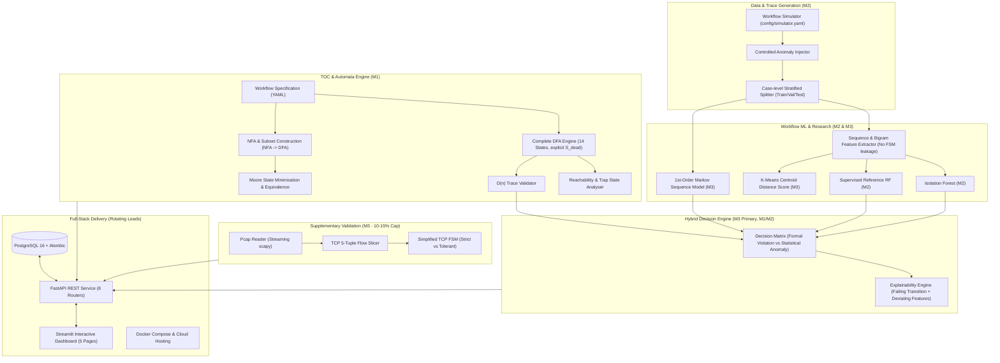

# 11 — Development Roadmap (Master Execution Blueprint)

**Project:** PS9 — Anomaly Detection in Process Workflows Using Automata and Machine Learning  
**Course Context:** 5th Semester Theory of Computation (TOC) — TA Activity  
**Team Allocation:** 3 Members (Balanced 112 / 112 / 112 Abstract Effort Points)  
**Assumed Timeline:** 8 Weeks (Compressible to 6 Weeks by dropping optional `[E]` items and Tier-B packet slice)

---

## 1. System Architecture & Component Interaction



---

## 2. Master Gantt Timeline (8-Week Plan)

```mermaid
gantt
    title PS9 Master Development Timeline (8 Weeks)
    dateFormat YYYY-MM-DD
    axisFormat W%W

    section Epoch 1: Foundations
    P0 Kickoff & Requirements Alignment (All)    :p0, 2026-01-05, 4d
    P1 Contracts, Types & Repository Scaffold (M1) :p1, after p0, 4d
    MS0 Contracts Frozen Tag                      :milestone, ms0, after p1, 0d

    section Epoch 2: Core Modules
    P2 Dataset Ingest, Simulator & Injector (M2)  :p2, after p1, 12d
    MS1 Validator v0 Handover (M1 -> M2)          :milestone, ms1, 2026-01-16, 0d
    P3 Automata Engine, Minimisation & Equiv (M1) :p3, after p1, 16d
    P4 ML Models: IF, Thresholds (M2) & Markov (M3):p4, after p2, 12d
    P5 Supplementary Packet FSM Experiment (M3)   :p5, 2026-01-26, 12d
    P6 Standalone Module Handover & Review (All)  :p6, after p3, 3d
    MS2 Standalone Modules Verified               :milestone, ms2, after p6, 0d

    section Epoch 3: Integration
    P7 Relational DB Schema & Repositories (M2/M3):p7, after ms2, 7d
    P8 FastAPI Backend Core & Routers (M1/All)    :p8, after p7, 8d
    P9 Hybrid Decision Matrix & Explanations (M3) :p9, after ms2, 8d
    P10 Sprint A (Lead: M2) Automata Full-Stack   :p10a, after p8, 5d
    P10 Sprint B (Lead: M1) ML/Hybrid Full-Stack  :p10b, after p10a, 6d
    P11 Streamlit Dashboard Shell & Pages (All)   :p11, after p8, 10d
    MS4 Integration Pipeline Verified             :milestone, ms4, after p10b, 0d

    section Epoch 4: Evaluation & Delivery
    P12 Empirical Evaluation & Latency Benchmarks (M3):p12, after ms4, 8d
    P13 Test Hardening & Leakage Auditing (All)   :p13, after p11, 6d
    P14 Dockerisation & Compose Packaging (M2)   :p14, after p13, 3d
    P15 Sprint C (Lead: M3) Cloud Deployment      :p15, after p14, 5d
    P16 Docs, Viva Drills & Demo Rehearsal (All)  :p16, after p12, 10d
    MS6 Project Shipped & Results Sealed          :milestone, ms6, after p16, 0d
```

---

## 3. Detailed Phase Breakdown

### P0 — Requirement Analysis & Ambiguity Resolution (Week 1)
- **Objective:** Establish common baseline; resolve ambiguities.
- **Tasks:** Review PS9 PDF together; review docs 01–02; clarify questions for TA (A1, A3, A8, A13); configure repo branch protection, issue board, and contribution log.
- **Responsible:** All members (M1 facilitates).
- **Deliverable:** Signed `02_Requirement_Analysis.md` with decisions recorded; TA consultation on A8 logged.
- **Done When:** Every ambiguity row has a concrete decision or assigned owner + target date.

### P1 — Workflow Contracts & Repository Scaffold (Week 1)
- **Objective:** Freeze shared data contracts and establish CI infrastructure.
- **Tasks:** Define `workflows/order_payment/workflow.yaml`; implement `src/common/types.py` and `interfaces.py`; configure Ruff, Makefile, `.env.example`, and GitHub Actions CI.
- **Responsible:** M1 primary; M2 reviewer; M3 contributor (pre-commit, Makefile).
- **Deliverable:** Git tag `contracts-v1` created.
- **Done When:** CI runs green on empty modules; type definitions import cleanly across all workstations.

### P2 — Dataset Ingestion, Simulator & Anomaly Injector (Weeks 2–3)
- **Objective:** Reproducible, labelled event log dataset with verified ground truth.
- **Tasks:** Implement `ingest.py`, `sequences.py`, `simulator.py` (path sampling with log-normal timing), `injector.py` (mutation rules), and `splits.py` (case-level stratified splits with held-out anomaly types); write `scripts/generate_dataset.py`.
- **Responsible:** M2 (M1 provides `validate_trace` v0 to verify injected labels).
- **Deliverable:** Sample dataset in `data/sample/` (`events.csv`, `labels.csv`, `meta.json`).
- **Done When:** Seed determinism test passes; label-verification test confirms 100% agreement between injected mutations and DFA verdicts.

### P3 — TOC Automata Engine & Verification (Weeks 2–4)
- **Objective:** Complete formal automata engine (Central Academic Contribution).
- **Tasks:** Implement `dfa.py`, `loader.py`, `validator.py` (delivering early v0 for M2); `nfa.py`, `conversion.py` (subset construction); `minimization.py` (Moore's algorithm); `equivalence.py` (product BFS); `reachability.py`; `visualize.py` (DOT generation); `variants.py` (bounded retry); `automata/cli.py`.
- **Responsible:** M1.
- **Deliverable:** Automata engine + CLI + unit and property tests.
- **Done When:** 100% of test cases in Doc 04 §11 pass; un-minimised vs minimised DFA equivalence confirmed; property tests pass via Hypothesis.

### P4 — ML Anomaly Detectors & Threshold Calibration (Weeks 3–4)
- **Objective:** Calibrated statistical and sequential anomaly detectors with zero data leakage.
- **Tasks:** M2: `features.py` (144 features with leakage guard test), `isolation_forest.py`, `thresholds.py` (calibrated at 5% target FPR on validation negatives), `random_forest.py` (supervised reference); M3: `markov.py` (Laplace-smoothed transition model), `kmeans_score.py`, `compare.py`.
- **Responsible:** M2 and M3.
- **Deliverable:** Detectors implementing `AnomalyDetector` interface; saved model artifacts; leakage audit.
- **Done When:** Serialisation round-trip tests pass; scores normalized to $[0, 1]$; zero data leakage confirmed.

### P5 — Supplementary Packet Validation (Weeks 4–5; Strictly Time-Boxed)
- **Objective:** Demonstrate automata validation on simplified TCP network flows.
- **Tasks:** Implement `reader.py` (streaming `PcapReader`), `flows.py` (5-tuple grouping), `mapper.py` (TCP flags $\to$ events), `tcp_fsm.yaml` + `tcp_fsm.py` (strict and tolerant profiles reusing M1's DFA class); prove $L(\text{Strict}) \subset L(\text{Tolerant})$ via `automata.equivalence`; generate report on Tier-A local capture.
- **Responsible:** M3; M1 reviewer.
- **Deliverable:** `src/packet/` module, packet experiment CLI, and scenario agreement report.
- **Budget Rule:** Strictly capped at 10–15% of project effort; no attack detection or IDS claims.

### P6 — Independent Module Milestone Review (End of Week 4)
- **Objective:** Cross-verify standalone deliverables before integration.
- **Tasks:** Each member runs a clean-clone checkout and tests peer modules via CLI; verify handover criteria per Doc 10 §4.
- **Done When:** Milestone sign-off completed by two reviewers per module (MS2).

### P7 — Database Layer & Migrations (Week 5)
- **Objective:** Persistent relational storage across all domains.
- **Tasks:** SQLAlchemy 2.0 models split across `models_automata.py` (M1), `models_workflow.py` (M2), `models_detection.py` and `models_packet.py` (M3); Alembic migrations; repository layer (M3 lead); `scripts/seed_db.py`.
- **Responsible:** M2 (schema lead), M3 (repositories lead), M1 (automata tables).
- **Done When:** `alembic upgrade head` runs cleanly on SQLite and PostgreSQL; repository CRUD tests pass.

### P8 — Backend REST API (Weeks 5–6)
- **Objective:** Production-grade REST API per Doc 08.
- **Tasks:** App factory, error formatting, upload limits, pagination (M1); routers implemented per owner (`automata.py` M1; `datasets.py`, `ml.py` M2; `detect.py`, `evaluation.py`, `reports.py`, `packet.py` M3); contract tests by non-authors.
- **Done When:** OpenAPI documentation available at `/docs`; all contract tests pass (MS3).

### P9 — Hybrid Detection Pipeline (Weeks 5–6)
- **Objective:** 4-row decision matrix with comprehensive explanations.
- **Tasks:** Implement `decision.py`, `explanation.py`, and `pipeline.py`; combine formal rule violation evidence with top-3 ML feature deviations.
- **Responsible:** M3; M1 reviewer; M2 contributor.
- **Done When:** Decision matrix unit tests pass; explanation completeness test confirms $\ge 1$ explanation for every flagged case.

### P10 — Integration Sprints A and B (Weeks 5–6)
- **Sprint A (Lead: M2):** Automata $\leftrightarrow$ DB $\leftrightarrow$ API $\leftrightarrow$ Dashboard Page 1 (`tests/integration/test_validate_flow.py`).
- **Sprint B (Lead: M1):** ML/Markov $\leftrightarrow$ DB $\leftrightarrow$ Hybrid $\leftrightarrow$ API $\leftrightarrow$ Dashboard Pages 2–4 (`tests/integration/test_detect_flow.py`).
- **Done When:** Full data-to-dashboard pipeline runs cleanly end-to-end (MS4).

### P11 — Streamlit Dashboard (Weeks 6–7)
- **Objective:** Interactive visualization interface without mockups or fake numbers.
- **Tasks:** Dashboard shell and client (M2); Page 1 Automata Explorer (M1); Page 2 Workflow Data & ML (M2); Page 3 Evaluation (M3); Page 4 Hybrid Detection (M1); Page 5 Packet Validation (M3).
- **Done When:** Execution paths render with red violation edges; provenance footers displayed; empty states handle missing data cleanly.

### P12 — Empirical Evaluation & Benchmarking (Weeks 7–8)
- **Objective:** Populate evaluation tables with stored, reproducible experimental runs.
- **Tasks:** `scripts/run_evaluation.py` evaluates FSM-only vs ML-only vs Hybrid across 5 seeds; records P/R/F1/FPR on `valid_variation` and latency into DB; populates Doc 12 result templates directly from DB queries.
- **Responsible:** M3; M2 reviewer; M1 baseline.
- **Done When:** All evaluation metrics populated from DB; zero hardcoded numbers.

### P13 — Testing Hardening & Audit (Week 7)
- **Objective:** Comprehensive test coverage and quality gate enforcement.
- **Tasks:** Run unit, property, contract, integration, and E2E suites; execute automated data leakage audit; review coverage ($\ge 80\%$ on automata and hybrid).
- **Done When:** CI green on `main`; coverage report archived.

### P14 — Docker Packaging (Week 7)
- **Objective:** One-command reproducible local deployment.
- **Tasks:** Build `docker/api.Dockerfile` and `docker/dashboard.Dockerfile`; create `docker-compose.yml` with PostgreSQL 16; write `scripts/smoke_test.py`.
- **Responsible:** M2 primary; M3 dashboard image; M1 reviewer.
- **Done When:** `docker compose up --build` boots clean clone and passes smoke test (MS5).

### P15 — Cloud Deployment (Sprint C) (Weeks 7–8)
- **Objective:** Live public demonstration environment.
- **Tasks:** Deploy DB + API (M1) and Dashboard (M3); run production smoke tests (M2); document rollback and seed procedures.
- **Responsible:** M3 lead (Sprint C).
- **Done When:** Public URLs live and responding; smoke test passes against live URLs (MS6).

### P16 — Documentation & Viva Preparation (Week 8)
- **Objective:** Final project presentation and defense readiness.
- **Tasks:** Finalize technical report; run fresh-clone verification of README; conduct internal peer viva examinations using Doc 15 question banks.
- **Done When:** All three team members can defend any component in the project during viva.

---

## 4. Milestone Schedule & Gates

| Milestone | Target | Exit Criteria | Deliverables |
|---|---|---|---|
| **MS0: Contracts Frozen** | End W1 | CI green, all 3 members approve `common/types.py` | Tag `contracts-v1`, `.env.example`, Makefile |
| **MS1: Validator v0 Ready** | Mid W2 | M1 delivers trace validator; unblocks M2 label verification | `src/automata/validator.py`, initial unit tests |
| **MS2: Core Modules Standalone** | End W4 | Each module runs CLI demo and passes unit suite in clean clone | Test reports for `automata/`, `workflow_ml/`, `research/`, `packet/` |
| **MS3: Backend Contract Tests** | End W5 | All 8 routers return documented JSON schemas; DB seeded | Passing contract tests in `tests/contract/`, live `/docs` |
| **MS4: Hybrid & Sprints A/B** | End W6 | End-to-end integration flows green on real DB | `test_validate_flow.py`, `test_detect_flow.py` |
| **MS5: Local Multi-Container Run** | Mid W7 | Local stack boots with zero manual intervention | `docker compose up --build` passes `smoke_test.py` |
| **MS6: Deployment & Viva Ready** | End W8 | Public cloud URLs live, real evaluation data stored in DB | Live system, finalized documentation, viva slide deck |

---

## 5. Team Distribution & Sprint Rotation

Workload is calibrated to **112 points per member** (Doc 10). Integration sprint leadership rotates to eliminate single points of failure:

| Sprint | Scope | Primary Lead | Second Reviewer | Third Contributor | Verification Exit Test |
|---|---|---|---|---|---|
| **Sprint A** | Automata $\leftrightarrow$ DB $\leftrightarrow$ API $\leftrightarrow$ Page 1 | **M2** | M3 | M1 | `test_validate_flow.py` |
| **Sprint B** | ML/Markov $\leftrightarrow$ DB $\leftrightarrow$ Hybrid $\leftrightarrow$ API $\leftrightarrow$ Pages 2–4 | **M1** | M2 | M3 | `test_detect_flow.py` |
| **Sprint C** | Packet $\leftrightarrow$ API $\leftrightarrow$ Page 5, E2E, Docker, Cloud Deploy | **M3** | M1 | M2 | `test_full_pipeline.py` & Smoke Test |

---

## 6. Risk Register & Mitigations

| Risk | Likelihood / Impact | Mitigation Strategy | Owner |
|---|---|---|---|
| Packet module scope creep | Medium / High | Strict 10–15% effort cap. Drop optional Tier-B slice if time runs short. | M3, reviewed weekly |
| Validator delay blocks M2 | Medium / Medium | M1 delivers minimal validator v0 by Day 10 (MS1). | M1 |
| Synthetic ML looks too artificial | High / Medium | Test on held-out anomaly types and borderline retry counts (3 retries); report honest limitations. | M2 & M3 |
| Missing Graphviz system binary | Medium / Low | Fallback to raw DOT code block or Plotly network diagram if `dot` binary is absent. | M1 & M3 |
| Free-tier hosting sleep / expiry | Medium / Medium | Fast DB seed script (`scripts/seed_db.py`), local Docker Compose backup, recorded demo backup. | M2 |
| Interface drift between modules | Medium / High | Unanimous approval required for `src/common`; automated API contract tests. | All |
| Workload imbalance | Medium / High | 112-point calibration; rotating sprint leadership; weekly effort logging. | All |
