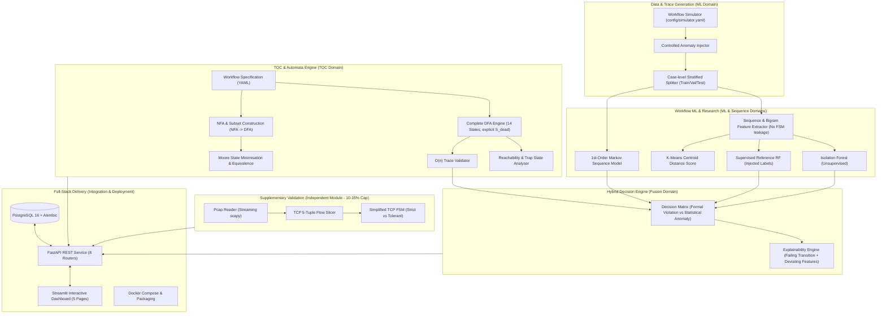
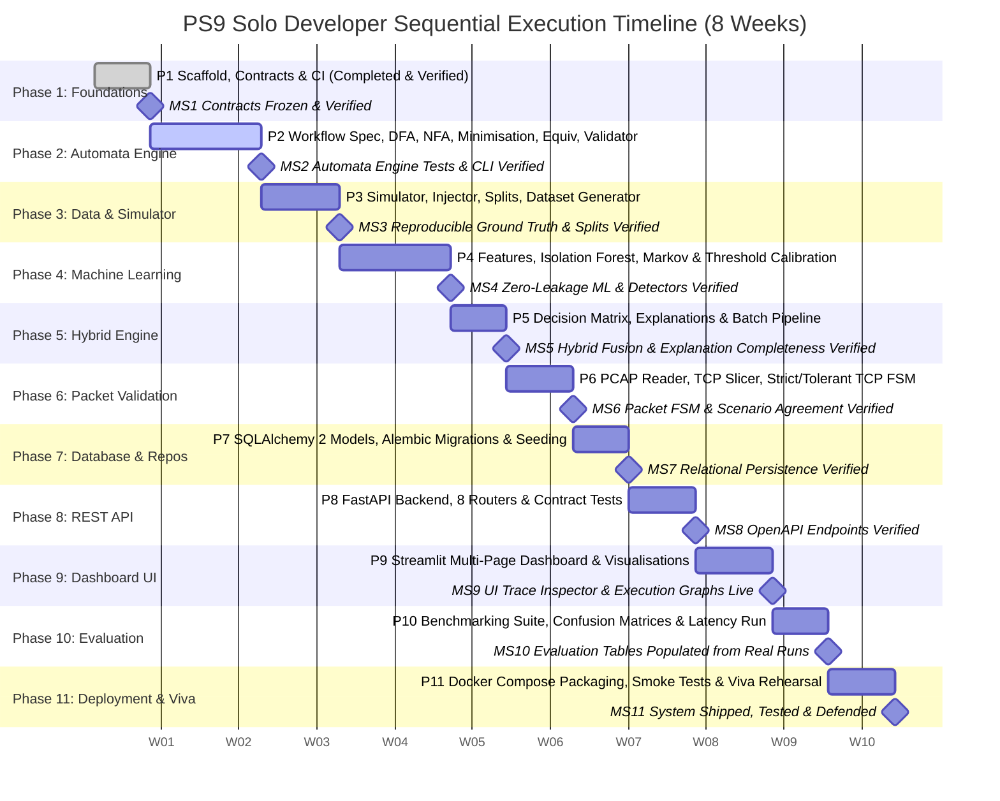

# 11 — Development Roadmap (Solo Developer Master Execution Blueprint)

**Project:** PS9 — Anomaly Detection in Process Workflows Using Automata and Machine Learning  
**Course Context:** 5th Semester Theory of Computation (TOC) — TA Activity  
**Execution Model:** Solo Developer (End-to-End Ownership across All Domains)  
**Assumed Timeline:** 8 Weeks (Compressible to 6 Weeks by dropping optional `[E]` items and Tier-B packet slice)

> **PROJECT UPDATE (Solo Developer Execution):** The project is implemented sequentially by a single developer. The developer develops, tests, and validates each phase before advancing to the next. Historical references to team member allocations (M1, M2, M3) are preserved solely as architectural domain tags.

---

## 1. System Architecture & Component Interaction

---

## 2. Master Solo Developer Gantt Timeline (8-Week Sequential Plan)

---

## 3. Detailed Phase Breakdown (Sequential Solo Execution)

### Phase 1 — Scaffold and Contracts (Completed & Verified)
- **Objective:** Freeze shared data contracts and establish CI/lint/test infrastructure.
- **Tasks Completed:** Root scaffolding (`pyproject.toml`, requirements, `Makefile`, `.env.example`, `.github/workflows/ci.yml`), authoritative dataclasses in `src/common/types.py`, `interfaces.py`, `config.py`, `logging.py`, and initial contract tests.
- **Status:** Complete (6/6 pytest tests passed; Ruff checks passed).

### Phase 2 — TOC Automata Engine & Trace Validator
- **Objective:** Complete formal automata engine (Central Academic Contribution).
- **Tasks:**
  1. Define `workflows/order_payment/workflow.yaml` (11 alphabet symbols, 13 live states + explicit $S_{\text{dead}}$) and `activity_map.yaml`.
  2. Implement `dfa.py`, `loader.py`, `validator.py`, and `explain.py`.
  3. Implement `nfa.py` (Thompson combinators), `conversion.py` (subset construction), `minimization.py` (Moore's algorithm), `equivalence.py` (product BFS), `reachability.py`, `visualize.py` (Graphviz DOT export), `variants.py` (bounded retry), and `automata/cli.py`.
  4. Write comprehensive unit and property tests verifying all hand-derived structural expectations from Doc 04 §6.
- **Done When:** All unit and property tests pass; unminimised vs minimised DFA equivalence confirmed; CLI `python -m src.automata.cli validate ...` functional.

### Phase 3 — Dataset Ingestion, Simulator & Anomaly Injector
- **Objective:** Reproducible, labelled event log dataset with verified ground truth.
- **Tasks:**
  1. Implement `ingest.py`, `sequences.py` (stable sorting by `(case_id, ts, row_idx)`).
  2. Implement `simulator.py` (path sampling with log-normal timing distributions from `config/simulator.yaml`).
  3. Implement `injector.py` (rule violations & statistical anomalies) using `automata.validator` to verify ground-truth labels.
  4. Implement `splits.py` (case-level stratified splits with held-out anomaly types).
  5. Create CLI `scripts/generate_dataset.py` writing `events.csv`, `labels.csv`, and `meta.json` into `data/sample/`.
- **Done When:** Seed reproducibility test passes; label verification test confirms 100% agreement with DFA verdicts; no case appears in multiple splits.

### Phase 4 — ML Anomaly Detectors & Calibration
- **Objective:** Calibrated statistical and sequential anomaly detectors with zero data leakage.
- **Tasks:**
  1. Implement `features.py` (144 sequence and timing features with automated leakage guard).
  2. Implement `isolation_forest.py` wrapping scikit-learn (convention: higher raw score = more anomalous).
  3. Implement `thresholds.py` (ECDF calibration on validation negatives for target FPR).
  4. Implement `markov.py` (first-order Markov chain with Laplace smoothing; mean vs. total negative log-likelihood).
  5. Implement `kmeans_score.py` (clustering centroid distance score) and `random_forest.py` (supervised reference under injected labels).
  6. Create CLI `scripts/train_models.py`.
- **Done When:** Detectors implement `AnomalyDetector` interface; score serialization round-trip tests pass; scores normalized to $[0, 1]$; zero data leakage confirmed.

### Phase 5 — Hybrid Decision Layer
- **Objective:** 4-row decision matrix with comprehensive explanations.
- **Tasks:**
  1. Implement `decision.py` implementing the deterministic 4-state table (`NORMAL`, `RULE_VIOLATION`, `STATISTICAL_ANOMALY`, `IN_PROGRESS`).
  2. Implement `explanation.py` generating ordered human-readable explanation sentences combining formal transition failure details with top feature deviations.
  3. Implement `pipeline.py` (`decide_batch`).
- **Done When:** Decision matrix unit tests cover all 4 rows; explanation completeness test confirms $\ge 1$ explanation for every non-NORMAL case.

### Phase 6 — Supplementary Packet Validation (Time-Boxed)
- **Objective:** Demonstrate automata validation on simplified TCP network flows.
- **Tasks:**
  1. Implement `reader.py` (streaming `PcapReader`), `flows.py` (5-tuple grouping), `mapper.py` (TCP flag precedence mapping).
  2. Implement `tcp_fsm.yaml` and `tcp_fsm.py` (strict and tolerant profiles reusing `automata.dfa.DFA`).
  3. Prove $L(\text{Strict}) \subset L(\text{Tolerant})$ via `automata.equivalence`.
  4. Implement `evaluate.py` producing scenario-agreement reports on Tier-A local captures.
- **Done When:** Packet unit tests pass on hand-built frames; strict $\subset$ tolerant equivalence verified; limitations documented.

### Phase 7 — Relational Database Layer & Migrations
- **Objective:** Persistent relational storage across all domains.
- **Tasks:**
  1. Implement SQLAlchemy 2.0 declarative models matching Doc 08 §3.
  2. Implement Alembic migrations.
  3. Implement repository layer for CRUD access on all entities.
  4. Implement `scripts/seed_db.py` seeding workflow, DFA, NFA, and minimised DFA from YAML specs.
- **Done When:** Migrations apply cleanly on SQLite and PostgreSQL; repository CRUD tests pass.

### Phase 8 — Backend REST API
- **Objective:** Production-grade REST API per Doc 08.
- **Tasks:**
  1. Implement FastAPI app factory, error handling, upload limits, optional API key authentication.
  2. Implement all 8 routers (`/automata`, `/datasets`, `/ml`, `/detect`, `/evaluation`, `/reports`, `/packet`, `/health`).
  3. Implement contract tests against all endpoints.
- **Done When:** OpenAPI docs live at `/docs`; all contract tests pass.

### Phase 9 — Interactive Dashboard
- **Objective:** Interactive Streamlit dashboard without mockups or fake numbers.
- **Tasks:**
  1. Implement `app.py` shell and navigation.
  2. Implement Page 1: Automata Explorer (trace inspector with red failing edge).
  3. Implement Page 2: Workflow Data & ML.
  4. Implement Page 3: Evaluation & Benchmarks.
  5. Implement Page 4: Hybrid Detection & Drill-down.
  6. Implement Page 5: Packet Validation.
- **Done When:** Execution paths render with Graphviz; all metrics come strictly from the live REST API.

### Phase 10 — Empirical Evaluation & Benchmarking
- **Objective:** Populate evaluation tables with stored, reproducible experimental runs.
- **Tasks:**
  1. Implement `scripts/run_evaluation.py` evaluating FSM-only vs. ML-only vs. Hybrid across multiple seeds.
  2. Record precision, recall, F1, FPR on `valid_variation`, latency, and confusion matrices into the database.
  3. Generate downloadable CSV/JSON benchmark reports.
- **Done When:** Tables R1–R6 populated from stored database queries; zero hardcoded metrics.

### Phase 11 — Docker Packaging, Smoke Testing & Viva Defense
- **Objective:** One-command reproducible execution and final project defense.
- **Tasks:**
  1. Finalize `docker-compose.yml`, `docker/api.Dockerfile`, and `docker/dashboard.Dockerfile`.
  2. Implement `scripts/smoke_test.py`.
  3. Verify fresh-clone build and end-to-end execution.
  4. Rehearse comprehensive viva questions (Doc 15) covering all modules.
- **Done When:** `docker compose up --build` passes smoke testing; project ready for live presentation and viva.

---

## 4. Risk Register & Mitigations (Solo Developer)

| Risk | Mitigation Strategy |
|---|---|
| Packet module scope creep | Strictly capped at $10\text{--}15\%$ of effort; drop Tier-B slices if needed. No IDS claims. |
| Data leakage in ML features | Enforce automated feature-name and column leakage tests in CI before training. |
| Interface drift | Frozen contracts in `src/common/types.py` remain immutable without explicit review. |
| Graphviz binary absence | Provide automatic fallback to raw DOT code blocks and Plotly graphs in UI. |
| Ephemeral cloud database loss | Maintain deterministic database seeding script (`scripts/seed_db.py`) to rebuild database on demand. |
