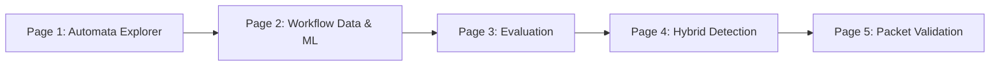

# 📘 Comprehensive User Guide & Booklet
## PS9 — Anomaly Detection in Process Workflows Using Automata and Machine Learning

---

## 🎯 1. Introduction: What is this Project?

In enterprise process workflows (such as an **Online Order & Payment System**), business processes must strictly follow formal rules (order cannot be shipped before payment is authorized). However, real systems also encounter subtle **statistical anomalies** (e.g. repeated payment failures, bot attacks, latency delays) that may not violate the syntax of transitions, but indicate abnormal behavior.

This platform bridges two distinct paradigms:
1. **Formal Language Theory (Automata / FSMs):**
   - Implements **DFA (Deterministic Finite Automata)** and **NFA (Non-deterministic Finite Automata)**.
   - Decides whether an execution trace belongs to the regular language $L(M)$ accepted by the business workflow.
   - Detects **Rule Violations** (out-of-order execution, skipped steps, unauthorized actions) with **0% False Positive Rate**.
2. **Machine Learning / Statistical Anomaly Detection:**
   - Evaluates statistical behavior across traces (execution duration, transition frequencies, retry attempts).
   - Utilizes **Isolation Forest**, **1st-Order Markov Chains**, **K-Means Clustering**, and a **Supervised Random Forest** reference model.
   - Detects **Statistical Anomalies** (e.g., 5 rapid retry attempts, unexpected timings).
3. **Hybrid Decision Fusion:**
   - Synthesizes formal FSM validation with statistical ML flags to produce explainable classifications:
     - `NORMAL`: Syntactically correct and statistically ordinary.
     - `RULE_VIOLATION`: Syntax/grammar violation rejected by the DFA.
     - `STATISTICAL_ANOMALY`: Syntactically valid trace, but statistically abnormal.
     - `IN_PROGRESS`: Valid prefix of an ongoing transaction.

---

## 🖥️ 2. How to Start and Stop the Platform

### Starting the Servers
Open PowerShell in the project directory:
```powershell
cd "D:\5th sem\TOC\TOC-Project-Git"
python run_servers.py
```
This automatically starts:
- **FastAPI Backend:** `http://localhost:8000` (API Docs: `http://localhost:8000/docs`)
- **Streamlit Frontend:** `http://localhost:8501`

### Stopping the Servers
Press `Ctrl + C` in the terminal window running `run_servers.py`, or terminate the processes:
```powershell
Get-Process -Name python, uvicorn, streamlit -ErrorAction SilentlyContinue | Stop-Process -Force
```

---

## 🧭 3. Walkthrough: The 5 Dashboard Pages

Access the dashboard in your web browser at **`http://localhost:8501`**. Use the left sidebar to navigate between pages.



---

### Page 1: 🔍 Automata Explorer (`1_Automata_Explorer.py`)
**Purpose:** Explore and formally analyze the workflow finite state machines.

#### What You Can Do Here:
1. **View Automata Representations:**
   - Switch between **DFA**, **Minimised DFA (Hopcroft's Algorithm)**, and **NFA**.
   - See interactive graph diagrams depicting states ($S_0 \to S_{12}$) and labeled transitions.
2. **NFA to DFA Conversion (Subset Construction):**
   - Click to observe power-set determinization step-by-step.
3. **Equivalence & Reachability:**
   - Run Hopcroft-Karp language equivalence tests between original and minimized DFAs.
4. **Interactive Trace Inspector:**
   - Select or type a sequence of events to trace the exact automaton execution path.
   - **Try this valid trace:**
     `OrderCreated` $\to$ `InventoryReserved` $\to$ `PaymentInitiated` $\to$ `PaymentAuthorized` $\to$ `OrderPacked` $\to$ `OrderShipped` $\to$ `OrderDelivered`
     - *Result:* **VALID_COMPLETE** (Reaches terminal state $S_{12}$).
   - **Try an invalid trace:**
     `OrderCreated` $\to$ `OrderShipped`
     - *Result:* **INVALID** (Fails at index 1: `OrderShipped` is illegal from state $S_1$).

---

### Page 2: 📊 Workflow Data & Machine Learning (`2_Workflow_Data_and_ML.py`)
**Purpose:** Generate or upload datasets, inspect cases, and train statistical models.

#### Key Tabs:
1. **Dataset Generation & Upload:**
   - View seeded synthetic event logs (e.g., `Order_Payment_Production_Sim_v1` with 500 cases).
   - Generate custom runs with adjustable anomaly injection rates (0.05 to 0.30).
2. **Case & Trace Explorer:**
   - Filter cases by split (`train`, `val`, `test`) or class (`normal`, `rule_violation`, `statistical_anomaly`).
   - Click on any case ID to inspect individual event logs, timestamps, and attributes.
3. **Train & Calibrate Detectors:**
   - Train detectors:
     - **Isolation Forest:** Tree-based spatial partitioning.
     - **Markov Sequence Model:** Transition log-likelihood probability.
     - **K-Means:** Centroid distance in feature space.
     - **Random Forest:** Supervised benchmark.
   - Adjust target False Positive Rate ($\alpha = 0.05$) calibrated via Empirical Cumulative Distribution Functions (ECDF).
4. **Model Metrics & Curves:**
   - Inspect ROC-AUC, PR-AUC, and score histograms distinguishing normal vs. anomalous cases.

---

### Page 3: 🏆 Empirical Evaluation & Benchmarks (`3_Evaluation.py`)
**Purpose:** Compare formal automata verification against ML and hybrid detection (Course Document 12 benchmark).

#### What to Look For:
- **Table R1 Comparison:**
  - **FSM Only:** $100\%$ precision on rule violations, $0\%$ false positive rate, but misses statistical timing anomalies.
  - **ML Only:** High sensitivity to distribution shifts, but introduces false alarms on rare valid business variations.
  - **Hybrid Fusion:** Delivers maximum F1 score while maintaining strict formal compliance.
- **Visuals:**
  - Multi-model comparative bar charts (Precision, Recall, F1).
  - Confusion Matrices (TP, FP, TN, FN).
  - Anomaly-type recall breakdowns.

---

### Page 4: ⚡ Hybrid Detection & Trace Analysis (`4_Hybrid_Detection.py`)
**Purpose:** Real-time hybrid inference on single traces or batch datasets.

#### Walkthrough:
1. **Interactive Trace Tester:**
   - Input custom event lists and select an ML consensus policy:
     - `any`: Flag anomaly if any ML detector triggers.
     - `all`: Flag anomaly only if all ML detectors agree.
   - Click **Run Hybrid Analysis**.
   - Review the **Verdict Card**:
     - FSM State Transition Path.
     - Individual Detector Anomaly Scores & Thresholds.
     - Human-readable explanation generation (e.g., "Event occurred out of sequence" or "Payment retry count deviated by $+2.8\sigma$").
2. **Batch Run Explorer:**
   - Browse the 106 pre-evaluated test cases.
   - Filter by `RULE_VIOLATION`, `STATISTICAL_ANOMALY`, or `NORMAL`.

---

### Page 5: 🌐 Network Packet Validation (`5_Packet_Validation.py`)
**Purpose:** Apply formal validation to low-level network communication (PCAP inspection).

#### Features:
- Inspect captured TCP/TLS session traces.
- Map packet headers (SYN, ACK, PUSH, FIN) to protocol automata.
- Detect out-of-order TCP state machine transitions or protocol tampering.

---

## 🧪 4. Quick-Start Example Traces to Test

Copy and paste these into **Page 1 (Trace Inspector)** or **Page 4 (Hybrid Detection)**:

### Test Case A: Clean Normal Order
```
OrderCreated, InventoryReserved, PaymentInitiated, PaymentAuthorized, OrderPacked, OrderShipped, OrderDelivered
```
- **FSM:** `VALID_COMPLETE`
- **Hybrid Result:** `NORMAL`

### Test Case B: Rule Violation (Skipping Payment)
```
OrderCreated, InventoryReserved, OrderPacked, OrderShipped
```
- **FSM:** `INVALID` (Illegal transition at `OrderPacked`)
- **Hybrid Result:** `RULE_VIOLATION`

### Test Case C: Statistical Anomaly (Excessive Retries)
```
OrderCreated, InventoryReserved, PaymentInitiated, PaymentFailed, PaymentRetried, PaymentFailed, PaymentRetried, PaymentAuthorized, OrderPacked, OrderShipped, OrderDelivered
```
- **FSM:** `VALID_COMPLETE` (Retries are syntactically permitted in the DFA loop)
- **ML Detection:** Flags high transition anomaly score due to excessive failure cycles.
- **Hybrid Result:** `STATISTICAL_ANOMALY`

---

## 🛠️ 5. Troubleshooting & FAQ

> [!NOTE]
> **Database File:** All state is saved in `D:\5th sem\TOC\TOC-Project-Git\ps9.db`.
> If you ever wish to re-seed or reset sample data, run:
> ```powershell
> python scripts/populate_sample_data.py
> ```

> [!TIP]
> **Graphviz Diagrams:**
> The web dashboard uses an embedded client-side renderer for the finite automata diagrams, so no system `dot` binary installation is required.
